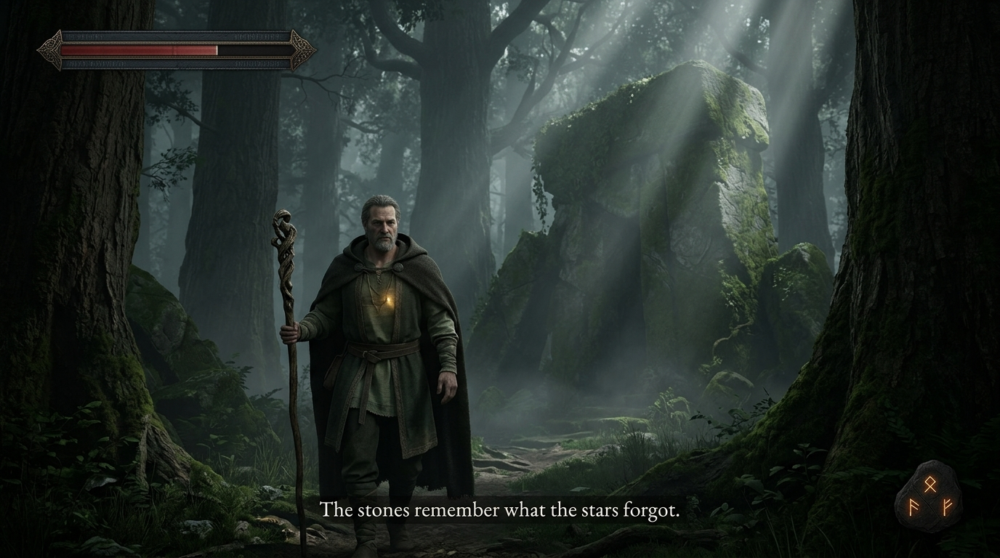
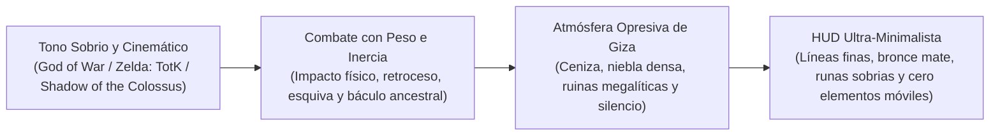

# ⚔️ DOCUMENTO MAESTRO: GAMEPLAY E INTERFAZ AAA (PRESTIGIO Y SOBRIEDAD)



> **Directriz de Iam (2026-10-22)**:  
> *«Esto parecía un juego de móvil barato con una UI dopamínica e infantil. Quiero un juego serio, con el peso, la atmósfera y la calidad de **God of War** o **The Legend of Zelda**, adaptado a mundos más contenidos pero con una factura visual y jugable equivalente».*

---

## 🎯 1. DIRECCIÓN DE TONO Y JUGABILIDAD



### 1.1 El Combate: Peso, Contundencia y Físicas
- **Impacto Físico y Reacción**:
  - Los golpes del báculo de raíz tienen **peso real** (inercia en el swing, micro-pausa de impacto o *hit-stop* cinematográfico de 2-3 fotogramas al golpear, y retroceso en el enemigo).
  - Efectos visuales de impacto maduros: astillas de madera viva, partículas de ceniza y ascuas doradas incandescentes, sin destellos coloridos de cómic.
- **Defensa y Esquiva Táctica**:
  - Parada (*parry*) precisa con el báculo que desvía ataques pesados con un destello ámbar sordo.
  - Esquiva terrestre con paso rápido y capa ondeando al ras del suelo.
- **Magia Ritual Ancestral**:
  - La magia no es un proyectil de caricatura; son **rituales de la tierra**:
    - *Púas de Raíz*: Grietas que se abren en la roca y lanzan estacas de madera petrificada hacia arriba.
    - *El Latido de Asili*: Onda de choque telúrica con temblor de cámara sutil que levanta polvo y desintegra la corrupción circundante.

### 1.2 La Exploración: Belleza Melancólica y Escala Épica
- Mundos más concentrados pero con **densidad e intensidad visual máxima**:
  - Ruinas colosales de civilizaciones antiguas que veneraban a los Primeros Árboles.
  - Iluminación dramática: claroscuros pronunciados, niebla volumétrica entre abetos centenarios, agua con reflejos oscuros y lecho de piedras húmedas.
  - El contraste entre la corrupción (silencio sepulcral, escombros calcinados, ceniza que cae del cielo) y la vida restaurada (luz solar que quiebra la niebla, vegetación espesa y fauna reverdeciente).

---

## 🏛️ 2. INTERFAZ DE USUARIO (HUD) DE PRESTIGIO Y SOBRIEDAD

### Principio Fundacional: "Menos es Más"
El jugador debe sentirse dentro de una obra cinematográfica. **Queda terminantemente prohibido cualquier elemento de juego casual móvil** (iconos circulares de colores vivos, brillos dopamínicos, marcos caricaturescos o barras gruesas de arcoíris).

```
+-------------------------------------------------------------------+
|  [=== Salud: Línea ultra-fina en bronce envejecido y pizarra ===]  |
|                                                                   |
|                                                                   |
|                                                                   |
|                      [ Escena 3D Cinemática ]                     |
|                                                                   |
|                                                                   |
|                                                                   |
|            MZEE SHAMBA: «La tierra aún recuerda su nombre.»        |
|                    (Subtítulo editorial sobrio)                   |
|                                                                   |
|                                            [ Runas geométricas ]  |
|                                            [   de Habilidad    ]  |
+-------------------------------------------------------------------+
```

### 2.1 Especificaciones de los Elementos del HUD:

1. **Barra de Vitalidad (Estilo *God of War* / *Elden Ring*)**:
   - Situada en la esquina superior izquierda.
   - Línea **ultra-fina y estilizada** ($4\text{ px}$ de grosor) contenida en un marco biselado de bronce mate oscuro y piedra de pizarra grabada con runas milenarias.
   - Relleno en carmesí apagado / ámbar profundo con un sutil degradado de envejecimiento.
   - **Desaparición Dinámica**: Se desvanece por completo cuando Maisha está fuera de combate con vida completa.
2. **Indicador de Habilidades y Artes de Asili**:
   - En la esquina inferior derecha.
   - Sutiles **glifos geométricos angulares** grabados en piedra volcánica mate con líneas de filigrana finísimas.
   - Al estar cargada una habilidad, el glifo emite una tenue brasa dorada interior, sin fuegos artificiales ni animaciones exageradas.
3. **Diálogos y Narrativa Cinemática**:
   - Cero bocadillos de caricatura sobre las cabezas.
   - **Subtítulos cinemáticos en tercio inferior**: Tipografía noble y refinada (serif clásico editorial estilo *Cinzel / Garamond / Trajan*), con interletraje generoso, sombra suave de oclusión y nombre del interlocutor en mayúsculas sobrias de bronce.
4. **Menú de Cartografía y Códice**:
   - Menú a pantalla completa que se abre con el peso de un códice antiguo de cuero desgastado.
   - Mapa dibujado a plumilla y tinta sobre pergamino curtido, con marcas topográficas y notas botánicas realistas.
