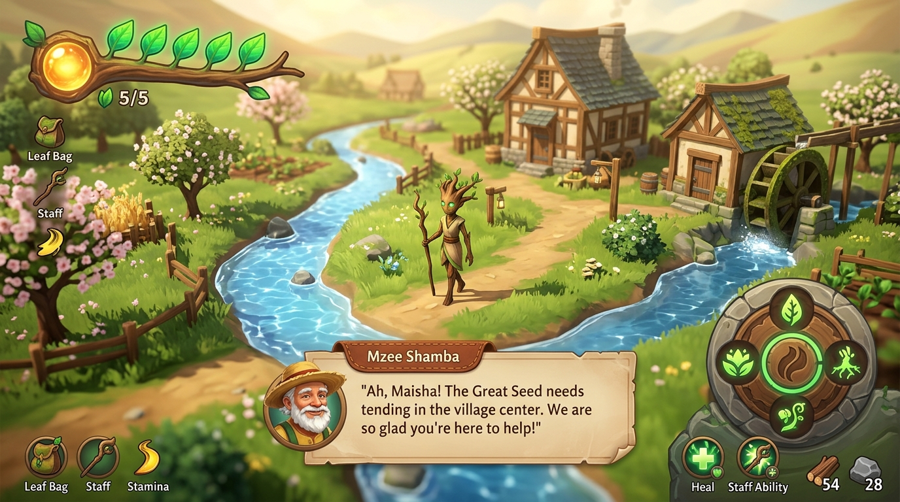
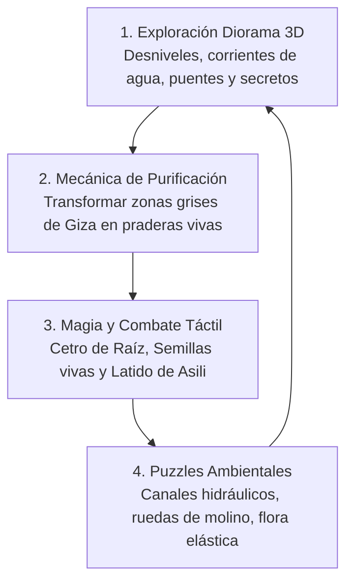

# 🎮 DISEÑO DE GAMEPLAY E INTERFAZ (UI / HUD) EN 3D: MAISHA



> **Visión**: Maisha es una aventura de acción y exploración atmosférica en perspectiva diorama 3D. El gameplay y la interfaz deben sentirse **táctiles, orgánicos, limpios y llenos de alma**, donde el propio mundo habla y la interfaz acompaña sin ensuciar la pantalla.

---

## 🌟 1. PILARES DEL GAMEPLAY EN 3D



### 1.1 Control y Físicas del Ser Místico
- **Respuesta Ágil e Inercia Orgánica**:
  - Movimiento suave analógico con aceleración natural. Al caminar, la túnica y la capa reaccionan al viento; al correr, el báculo se inclina hacia adelante.
- **Interacción Física con el Entorno**:
  - La hierba 3D se dobla físicamente al paso de Maisha mediante shaders de empuje.
  - Al cruzar acequias y charcos, se generan ondas circulares y pequeñas salpicaduras de espuma.
  - Al caminar por nieve o lodo, quedan huellas tridimensionales efímeras que se van cubriendo con el tiempo.

### 1.2 La Mecánica Central: Purificación Dinámica del Mundo
- El mayor placer del juego es **ver el mundo recuperar la vida en tiempo real**:
  - Al entrar en una zona corrupta por **Giza**, la atmósfera se vuelve gris, fría, con espinas negras, niebla espesa y música apagada.
  - Al romper los núcleos de corrupción con el Cetro o el Latido, **una onda expansiva de luz dorada barre el diorama**: la hierba brota de golpe, las flores se abren, el agua se vuelve turquesa y la música despierta con instrumentos vivos (cora, flautas de madera y cuerdas).

### 1.3 Combate y Magia con Semillas
- **Golpe de Cetro (Ataque Básico)**:
  - Ataque rítmico en arco de $180^\circ$ que disipa ceniza, desvía proyectiles de esporas y aturde a las criaturas de óxido.
- **Siembra de Semillas Tridimensionales**:
  - *Semilla Explosiva*: Crece en 1 segundo y estalla en cruz con pétalos ardientes que limpian maleza y espinas.
  - *Semilla Rebotadora (Hongo Trampolín)*: Crece al instante como una gran seta elástica que permite a Maisha impulsarse verticalmente hacia riscos y techos.
  - *Semilla de Luz*: Florece emitiendo un faro de luz dorada que ilumina cavernas y ahuyenta a las babosas de sombra.
- **El Latido de Asili**:
  - Pulso radial místico en $360^\circ$ que repele a los enemigos alrededor, despierta estatuas antiguas de los Olvidados y activa mecanismos de piedra sellados.

---

## 🎨 2. DISEÑO DE LA INTERFAZ DE USUARIO (UI / HUD)

### Filosofía: HUD Minimalista y Diegético
El juego no debe parecer una pantalla llena de barras de plástico. **En momentos de paz y exploración, el HUD se oculta al 100%**, dejando que la belleza del diorama respire libremente.

```
+---------------------------------------------------------------+
| [🌿 Hojas de Vida (5)]                                       |
| [☀️ Orbe de Aliento]                                         |
|                                                               |
|                                                               |
|                      [ Escena 3D Diorama ]                    |
|                                                               |
|              +------------------------------+                 |
|              |  Mzee Shamba (Diálogo)       |                 |
|              |  «El agua vuelve a correr...»|                 |
|              +------------------------------+                 |
|                                                               |
|                                       [🌾 Dial de Semillas]   |
|                                       [   y Habilidades   ]   |
+---------------------------------------------------------------+
```

### 2.1 Elementos del HUD (Solo visibles cuando se necesitan):
1. **Salud: Las Hojas de la Corona (Esquina Superior Izquierda)**:
   - Una rama viva estilizada que abraza el borde con **5 hojas verdes frescas y brillantes**.
   - Al recibir daño, una hoja se marchita en tonos ocres y cae como una pequeña partícula.
   - En la propia Maisha (diegético): su resplandor dorado parpadea si le queda solo 1 hoja de vida.
2. **Aliento Vital: El Orbe de Asili (Junto a las Hojas)**:
   - Un orbe tallado en ámbar y oro en el nudo de la rama. Se llena de luz líquida al explorar o golpear, y se consume al sembrar semillas o lanzar el Latido.
3. **Dial Circular de Semillas (Esquina Inferior Derecha)**:
   - Un selector radial discreto tallado en piedra de río y madera que muestra la semilla o arte activo, con iconos orgánicos grabados a mano.
4. **Caja de Diálogo Cálida**:
   - Bocadillo de pergamino suave con bordes de acuarela flotando cerca del personaje, con el retrato dibujado a mano del interlocutor y balbuceos acústicos rústicos (flautas y cuerdas suaves).
5. **Menú de Pausa: El Cuaderno de Viaje**:
   - No es una lista genérica: se abre como un **cuaderno de campo encuadernado en cuero sobre un tablero de madera**, con el mapa ilustrado en pergamino, el bestiario con anotaciones botánicas y las piezas de vestimenta equipables.
