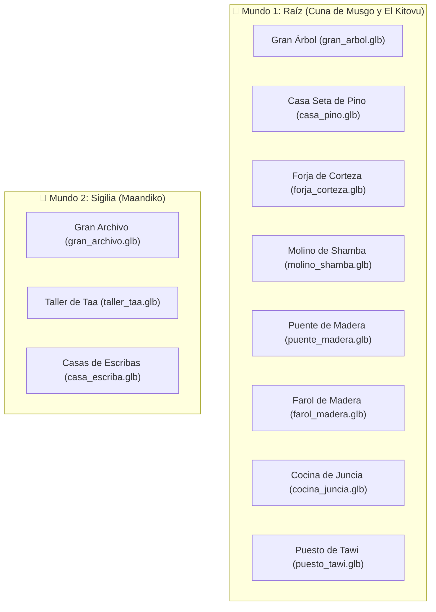

# Catálogo de Modelos 3D y Arquitectura HD-2D — Maisha

> **Bóveda de Obsidian**: [[LEEME]] · [[documentacion/decisiones|Decisiones de Diseño]] · [[documentacion/coordinacion|Coordinación Claude ⟷ Gemini]]
> **Pipeline Gráfico**: Blender 4.5.15 LTS (Headless procedural via `bpy`) $\rightarrow$ Godot 4.7.2 (GL Compatibility HD-2D).
> **Tags**: #maisha #hd2d #blender #arquitectura #modelos3d #gamedev

---

## 1. Filosofía HD-2D de Maisha (Modelo *Octopath Traveler*)

Maisha combina dos mundos para lograr su identidad visual única:
1. **Entidades Vivas (Personajes, Aldeanos, Criaturas y Jefes)**:
   - Sprites de pixel art artesanal colocados en posición vertical (*Y-Billboard*).
   - Volumen 3D mediante extrusión multicapa (`capas_fondo`) y sombreado de curvatura cilíndrica.
   - Mapas de normales (`*_n.png`) horneados para reaccionar físicamente a la luz del sol y a las luces cálidas nocturnas.
2. **Escenario y Arquitectura (Edificios, Casas, Puentes, Árboles y Farolas)**:
   - **Modelos 3D sólidos reales (`.glb`)** modelados procedimentalmente con Blender 4.5.
   - Paleta cromática oficial de Raíz y Sigilia con filtrado de píxel `NEAREST`.
   - Geometría completa de 360° con aleros, chimeneas, porches y proyección de sombras volumétricas dinámicas.

---

## 2. Paleta Oficial de Materiales Principled BSDF

| Material | Código Hex | Acabado (Roughness / Met) | Emisión de Luz | Uso Principal |
| :--- | :--- | :--- | :--- | :--- |
| `Mat_Maisha_Cuerpo` | `#FFE08A` | $0.50$ / $0.00$ | — | Piel dorada del brote de Maisha |
| `Mat_Corazon_Asili` | `#DF9022` | $0.20$ / $0.00$ | `#FFF8E8` ($2.2$) | Núcleo de Asili y llamas vivas |
| `Mat_Brote_Verde` | `#6FCF4F` | $0.40$ / $0.00$ | `#86EFAC` ($0.3$) | Brote y vegetación viva |
| `Mat_Arbol_Corteza` | `#452B1F` | $0.90$ / $0.00$ | — | Madera oscura del Gran Árbol y vigas |
| `Mat_Musgo_Hojas` | `#365314` | $0.60$ / $0.00$ | — | Tejados vegetales y copas |
| `Mat_Madera_Tablas` | `#854D0E` | $0.70$ / $0.00$ | — | Fachadas de casas y puentes |
| `Mat_Piedra_Plaza` | `#64748B` | $0.80$ / $0.00$ | — | Muros de mampostería y forjas |
| `Mat_Marmol_Sigilia` | `#E2E8F0` | $0.50$ / $0.00$ | — | Mármol blanco y columnas de Maandiko |
| `Mat_Teja_Cobriza` | `#C2410C` | $0.60$ / $0.00$ | — | Tejas a dos aguas de Sigilia |
| `Mat_Tinta_Sigilia` | `#312E81` | $0.30$ / $0.00$ | `#4F46E5` ($1.2$) | Frascos de tinta y vitrales de escribas |
| `Mat_Farol_Luz` | `#FDE047` | $0.20$ / $0.00$ | `#FEF08A` ($4.0$) | Linternas de farol y cristales |

---

## 3. Catálogo de Arquitectura y Props 3D (`modelos/entorno/`)



### Detalle de Modelos Integrados:

1. **`gran_arbol.glb`**
   - Altura: $6.2\text{ m}$. Tronco colosal hueco con portal al Claro de Calma y copa de musgo escalonada.
   - Vinculado a: `gran_arbol.png`.
2. **`casa_pino.glb`**
   - Altura: $3.4\text{ m}$. Paredes de troncos, tejado cónico de seta carmesí, chimenea de piedra y farolillo exterior.
   - Vinculado a: `casa_seta.png` (se activa al reconstruir la casa con Pino).
3. **`forja_corteza.glb`**
   - Altura: $2.8\text{ m}$. Horno de piedra volcánica con chimenea humeante, brasas encendidas y yunque de hierro.
   - Vinculado a: `taller.png` (se activa al reconstruir el taller de Corteza).
4. **`molino_shamba.glb`**
   - Altura: $3.5\text{ m}$. Cabaña de tablones con rueda hidráulica lateral de 16 palas para acequias.
   - Vinculado a: `molino.png`.
5. **`puente_madera.glb`**
   - Longitud: $3.2\text{ m}$. Tablones curvados con 6 postes de sujeción y pasamanos rústicos.
   - Vinculado a pasos de río y pasarelas.
6. **`farol_madera.glb`**
   - Altura: $2.4\text{ m}$. Poste de madera con brazo curvo y esfera de farol con iluminación omnidireccional cálida.
   - Vinculado a: `farol.png` y `farol_apagado.png`.
7. **`cocina_juncia.glb`**
   - Altura: $3.2\text{ m}$. Cabaña comunitaria con techo de musgo, chimenea y caldero frontal con fuego de Asili.
   - Vinculado a: `cocina.png`.
8. **`puesto_tawi.glb`**
   - Altura: $2.3\text{ m}$. Mostrador con 4 postes, toldo de tela a dos aguas y cajas con semillas doradas.
   - Vinculado a: `puesto.png`.
9. **`gran_archivo.glb`**
   - Altura: $5.2\text{ m}$. Escalinata de mármol, 4 columnas monumentales, frontón clásico y cúpula dorada.
   - Vinculado a: `gran_archivo.png`.
10. **`taller_taa.glb`**
    - Altura: $4.2\text{ m}$. Edificio urbano de dos plantas con planta baja de piedra, voladizo de madera y frasco de tinta de Sigilia.
    - Vinculado a: `taller_taa.png`.
11. **`casa_escriba.glb`**
    - Altura: $3.6\text{ m}$. Vivienda tradicional de Maandiko con muros encalados, balcón de madera y tejas cobrizas.
    - Vinculado a: `casa_escriba.png` y `casa_kalamu.png`.

---

## 4. Pipeline de Regeneración Automática

Para regenerar todos los modelos desde terminal:
```bash
/Applications/Blender.app/Contents/MacOS/Blender -b -P herramientas/blender/generador_3d_maisha.py
```
Los archivos `.glb` se exportan directamente a `modelos/entorno/`, `modelos/enemigos/` y `modelos/personajes/`, listos para ser consumidos automáticamente por [`espejo_hd2d.gd`](file:///Users/iinfafer/Proyectos/maisha-revision/scripts/mundo/hd2d/espejo_hd2d.gd).
