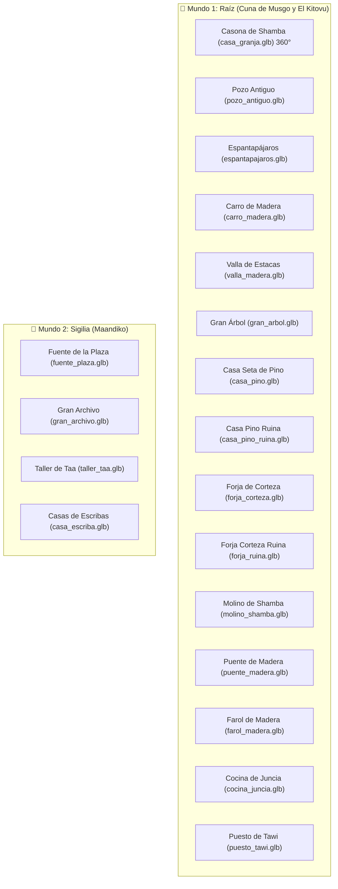

# Catálogo de Modelos 3D y Arquitectura HD-2D — Maisha

> **Bóveda de Obsidian**: [[LEEME]] · [[documentacion/decisiones|Decisiones de Diseño]] · [[documentacion/coordinacion|Coordinación Claude ⟷ Gemini]]
> **Pipeline Gráfico**: Blender 4.5.15 LTS (Headless procedural via `bpy`) $\rightarrow$ Godot 4.7.2 (GL Compatibility HD-2D).
> **Tags**: #maisha #hd2d #blender #arquitectura #modelos3d #gamedev

---

## 1. Filosofía HD-2D de Maisha (Modelo *Octopath Traveler*)

Maisha combina dos mundos para lograr su identidad visual única:
1. **Entidades Vivas (Personajes, Aldeanos, Criaturas y Jefes)**:
   - Sprites de pixel art artesanal colocados en posición vertical (*Y-Billboard*).
   - Volumen 3D mediante extrusión multicapa (`capas_fondo`) y sombreado de curvatura cilíndrica.
   - Mapas de normales (`*_n.png`) horneados para reaccionar físicamente a la luz del sol y a las luces cálidas nocturnas.
2. **Escenario y Arquitectura (Edificios, Casas, Puentes, Árboles y Farolas)**:
   - **Modelos 3D sólidos reales (`.glb`)** modelados procedimentalmente con Blender 4.5.
   - Paleta cromática oficial de Raíz y Sigilia con filtrado de píxel `NEAREST`.
   - Geometría completa de 360° con aleros, chimeneas, porches y proyección de sombras volumétricas dinámicas.

---

## 2. Paleta Oficial de Materiales Principled BSDF

| Material | Código Hex | Acabado (Roughness / Met) | Emisión de Luz | Uso Principal |
| :--- | :--- | :--- | :--- | :--- |
| `Mat_Maisha_Cuerpo` | `#FFE08A` | $0.50$ / $0.00$ | — | Piel dorada del brote de Maisha |
| `Mat_Corazon_Asili` | `#DF9022` | $0.20$ / $0.00$ | `#FFF8E8` ($2.2$) | Núcleo de Asili y llamas vivas |
| `Mat_Brote_Verde` | `#6FCF4F` | $0.40$ / $0.00$ | `#86EFAC` ($0.3$) | Brote y vegetación viva |
| `Mat_Arbol_Corteza` | `#452B1F` | $0.90$ / $0.00$ | — | Madera oscura del Gran Árbol y vigas |
| `Mat_Musgo_Hojas` | `#365314` | $0.60$ / $0.00$ | — | Tejados vegetales y copas |
| `Mat_Madera_Tablas` | `#854D0E` | $0.70$ / $0.00$ | — | Fachadas de casas y puentes |
| `Mat_Piedra_Plaza` | `#64748B` | $0.80$ / $0.00$ | — | Muros de mampostería y forjas |
| `Mat_Marmol_Sigilia` | `#E2E8F0` | $0.50$ / $0.00$ | — | Mármol blanco y columnas de Maandiko |
| `Mat_Teja_Cobriza` | `#C2410C` | $0.60$ / $0.00$ | — | Tejas a dos aguas de Sigilia |
| `Mat_Tinta_Sigilia` | `#312E81` | $0.30$ / $0.00$ | `#4F46E5` ($1.2$) | Frascos de tinta y vitrales de escribas |
| `Mat_Farol_Luz` | `#FDE047` | $0.20$ / $0.00$ | `#FEF08A` ($4.0$) | Linternas de farol y cristales |
| `Mat_Paja_Dorada` | `#D97706` | $0.80$ / $0.00$ | — | Fardos de paja, sombreros y cabezas de espantapájaros |
| `Mat_Madera_Tronco`| `#5C381E` | $0.75$ / $0.00$ | — | Troncos macizos de cabaña y estacas de valla |
| `Mat_Madera_Viga`  | `#78350F` | $0.70$ / $0.00$ | — | Vigas estructurales, marcos de puertas y ruedas de carro |
| `Mat_Piedra_Oscura`| `#334155` | $0.85$ / $0.00$ | — | Remates de chimenea y zócalos de mampostería pesada |

---

## 3. Catálogo de Arquitectura y Props 3D (`modelos/entorno/`)



### Detalle de Modelos Integrados:

1. **`casa_granja.glb` (El Kitovu - Mzee Shamba)**
   - Dimensiones: $8.8\times 2.4\times 5.2\text{ m}$.
   - Arquitectura: Casona de troncos macizos completa en 360°, zócalo de mampostería perimetral de piedra, paredes de troncos macizos en 360°, fachada frontal y trasera UV-mapeadas a texturas de pixel art oficiales (`casa_granja.png` y `trasera_casa_granja.png`), tejado a dos aguas de paja dorada con aleros voladizos en 360°, porche frontal con postes y farol cálido, buhardilla iluminada en la vertiente frontal, chimenea de mampostería de piedra ($6.2\text{ m}$) y rueda de molino de agua hidráulica con palas de madera.
   - Materiales: `Mat_Granja_Frontal`, `Mat_Granja_Trasera`, `Mat_Granja_Tejado` (`tejado_paja_tile.png`), `Mat_Granja_Troncos` (`pared_troncos_tile.png`), `Mat_Granja_Piedra` (`mamposteria_tile.png`), `Mat_Molino`.
   - Transparencia: Conexión con `_actualizar_transparencias_edificios()` al caminar Maisha por detrás (38% alfa suave).
   - Vinculado a: `casa_granja.png` y `casa_shamba.png`.
2. **`pozo_antiguo.glb` (El Kitovu)**
   - Altura: $2.25\text{ m}$. Brocal circular de mampostería de piedra texturizada (`mamposteria_tile.png`), espejo de agua reflectante interior, dos postes de madera verticales, eje giratorio con manivela y cuerda dorada, cubo suspendido y tejadillo a dos aguas de paja dorada (`tejado_paja_tile.png`) con aleros en 360°.
   - Vinculado a: `pozo.png`.
3. **`espantapajaros.glb` (El Kitovu)**
   - Altura: $1.9\text{ m}$. Poste vertical con travesaño de brazos, cabeza de paja dorada con sombrero cónico rústico y poncho verde oliva de castor.
   - Vinculado a: `espantapajaros.png`.
4. **`carro_madera.glb` (El Kitovu)**
   - Dimensiones: $1.8\times 1.4\times 0.9\text{ m}$. Plataforma de tablas con textura de troncos (`pared_troncos_tile.png`), barandillas laterales y trasera, varales de tiro, eje de metal forjado, ruedas con radios de madera y carga de heno texturizado (`tejado_paja_tile.png`).
   - Vinculado a: `carro.png`.
5. **`valla_madera.glb` (Universal)**
   - Dimensiones: $1.1\times 0.2\times 1.0\text{ m}$. Segmento modular de valla con dos postes cilíndricos rematados en punta biselada y dos travesaños horizontales macizos en 3D.
   - Vinculado a: `valla.png` y `cerca.png`.
6. **`casa_pino_ruina.glb` (Cuna de Musgo - Estado Inicial)**
   - Altura: $1.8\text{ m}$. Muros circulares derruidos a media altura, vigas rotas que asoman en ángulo, cubierta cónica de seta roja partida y desplomada sobre el terreno, con bloques de piedra y escombros esparcidos en 360°.
   - Vinculado a: `casa_seta.png` (cuando `frame == 0`) y `ruina_casa.png`.
7. **`forja_ruina.glb` (Cuna de Musgo - Estado Inicial)**
   - Altura: $1.6\text{ m}$. Horno de forja quebrado y agrietado, chimenea inclinada y desmoronada, tocón de soporte volcado, yunque de hierro caído en el suelo y escombros rocosos.
   - Vinculado a: `taller.png` (cuando `frame == 0`).
8. **`fuente_plaza.glb` (Sigilia - Plaza de Maandiko)**
   - Dimensiones: Diámetro $3.5\text{ m}$, Altura $2.1\text{ m}$. Pila octogonal exterior de mármol blanco, lámina de agua reflectante, pedestal central esculpido, taza superior y surtidor de agua.
   - Vinculado a: `fuente.png` y `fuente_plaza.png`.
9. **`gran_arbol.glb`**
   - Altura: $6.2\text{ m}$. Tronco colosal hueco con portal al Claro de Calma y copa de musgo escalonada.
   - Vinculado a: `gran_arbol.png`.
10. **`casa_pino.glb`**
    - Altura: $3.4\text{ m}$. Paredes de troncos, tejado cónico de seta carmesí, chimenea de piedra y farolillo exterior.
    - Vinculado a: `casa_seta.png` (cuando `frame >= 1`, tras ser reconstruida).
11. **`forja_corteza.glb`**
    - Altura: $2.8\text{ m}$. Horno de piedra volcánica con chimenea humeante, brasas encendidas y yunque de hierro.
    - Vinculado a: `taller.png` (cuando `frame >= 1`, tras ser reconstruida).
12. **`molino_shamba.glb`**
    - Altura: $3.5\text{ m}$. Cabaña de tablones con rueda hidráulica lateral de 16 palas para acequias.
    - Vinculado a: `molino.png`.
13. **`puente_madera.glb`**
    - Longitud: $3.2\text{ m}$. Tablones curvados con 6 postes de sujeción y pasamanos rústicos.
    - Vinculado a pasos de río y pasarelas.
14. **`farol_madera.glb`**
    - Altura: $2.4\text{ m}$. Poste octogonal con basa de piedra, collarines de hierro forjado, brazo con tornapunta diagonal, argolla de suspensión y linterna hexagonal con caperuza cónica y celosía con núcleo incandescente cálido en 360°.
    - Vinculado a: `farol.png` y `farol_apagado.png`.
15. **`cocina_juncia.glb`**
    - Altura: $3.2\text{ m}$. Cabaña comunitaria con techo de musgo, chimenea y caldero frontal con fuego de Asili.
    - Vinculado a: `cocina.png`.
16. **`puesto_tawi.glb`**
    - Altura: $2.3\text{ m}$. Mostrador con 4 postes, toldo de tela a dos aguas y cajas con semillas doradas.
    - Vinculado a: `puesto.png`.
17. **`gran_archivo.glb`**
    - Altura: $5.2\text{ m}$. Escalinata de mármol, 4 columnas monumentales, frontón clásico y cúpula dorada.
    - Vinculado a: `gran_archivo.png`.
18. **`taller_taa.glb`**
    - Altura: $4.2\text{ m}$. Edificio urbano de dos plantas con planta baja de piedra, voladizo de madera y frasco de tinta de Sigilia.
    - Vinculado a: `taller_taa.png`.
19. **`casa_escriba.glb`**
    - Altura: $3.6\text{ m}$. Vivienda tradicional de Maandiko con muros encalados, balcón de madera y tejas cobrizas.
    - Vinculado a: `casa_escriba.png` y `casa_kalamu.png`.
20. **`kitovu_ruina.glb` (El Kitovu - Ruinas de Granja)**
    - Dimensiones: $3.2\times 2.2\times 1.6\text{ m}$. Zócalo de piedra masivo, muros rotos en escuadra a diferente altura, vigas de roble fracturadas y montones de escombros de mampostería en 360°.
    - Vinculado a: `ruina_casa.png`.
21. **`cocina_ruina.glb` (Cuna de Musgo - Cocina Derruida)**
    - Altura: $1.8\text{ m}$. Muros de tablones quebrados, chimenea partida en ángulo, techo cónico colapsado y caldero de hierro volcado en el fango.
    - Vinculado a: `cocina.png` (cuando `frame == 0`).
22. **`puesto_ruina.glb` (Cuna de Musgo - Puesto Colapsado)**
    - Altura: $1.5\text{ m}$. Mostrador inclinado y vencido, postes fracturados, toldo desfondado y cajas de madera desvencijadas en 360°.
    - Vinculado a: `puesto.png` (cuando `frame == 0`).
23. **`casa_juncos.glb` (Embarcadero Junco - Cabaña sobre Pilotes)**
    - Dimensiones: $3.6\times 2.6\times 4.4\text{ m}$. Pilotes de madera sobre el agua, plataforma de tablones texturizados (`pared_troncos_tile.png`), paredes de caña/juncos, tejado a dos aguas de paja dorada (`tejado_paja_tile.png`) con aleros en 360°, puerta rústica, barandilla de madera, farol cálido frontal y ventana trasera iluminada.
    - Vinculado a: `casa_juncos.png` y `casa_barcas.png`.
24. **`casa_bata.glb` (Embarcadero Junco - Cabaña del Barquero Bata)**
    - Dimensiones: $3.2\times 2.4\times 4.2\text{ m}$. Pilotes de tronco sobre el agua, paredes de madera vieja texturizada (`pared_troncos_tile.png`), tejado a dos aguas de teja cobriza (`teja_cobriza_tile.png`) en 360°, barril de provisiones, farol frontal y ventana trasera.
    - Vinculado a: `casa_bata.png`.
25. **`casa_nungu.glb` (Paso Piedra / Paso Escarcha - Refugio de Montaña)**
    - Dimensiones: $4.2\times 2.8\times 5.25\text{ m}$. Mampostería maciza de granito texturizada (`forja_mamposteria_tile.png`), esquinas de sillar oscuro reforzadas, tejado alpino empinado de pizarra, gran chimenea de piedra con caperuza y ventanas iluminadas delantera y trasera.
    - Vinculado a: `casa_nungu.png`.
26. **`granero.glb` (Campo Segado - Granero Agrícola)**
    - Dimensiones: $6.8\times 3.6\times 5.8\text{ m}$. Zócalo perimetral de piedra (`mamposteria_tile.png`), paredes de tablones agrícolas de madera roja con vigas blancas de refuerzo, tejado a dos aguas de teja cobriza (`teja_cobriza_tile.png`), portón doble de madera, vano superior de pajar con polea, fardo de heno dorado (`tejado_paja_tile.png`) y ventanas traseras.
    - Vinculado a: `granero.png`.
27. **`palafito.glb` (Las Pasarelas - Choza de Bambú Flotante)**
    - Dimensiones: $3.4\times 2.8\times 4.9\text{ m}$. Altos pilotes para aguas profundas, plataforma perimetral con barandillas de madera, choza de bambú, tejado a dos aguas de paja dorada (`tejado_paja_tile.png`), farol colgante y ventana trasera.
    - Vinculado a: `palafito.png`.
28. **`horreo.glb` (Senda de los Surcos - Hórreo de Sungura)**
    - Dimensiones: $2.8\times 2.2\times 3.6\text{ m}$. Hórreo elevado sobre 4 pilares de piedra con tornarratos circulares (piedras muela), cuerpo de tablones de madera, tejadillo a dos aguas de teja cobriza, escalera lateral y ventana trasera con luz cálida.
    - Vinculado a: `horreo.png`.
29. **`campamento.glb` (Sendero del Puente - Campamento de Msafiri)**
    - Dimensiones: $3.6\times 3.0\times 2.2\text{ m}$. Tienda de campaña de lona triangular a dos aguas, fogata circular de piedras de río con brasas incandescentes y leños cruzados, tocón de asiento y cajas de provisiones rústicas en 360°.
    - Vinculado a: `campamento.png`.
30. **`puesto_tinta.glb` (Maandiko - Puesto de Tinta y Pergaminos de Wino)**
    - Dimensiones: $3.0\times 2.2\times 2.8\text{ m}$. Mostrador urbano de mármol con postes de bronce bruñido, toldo de rayas azules y púrpuras de Sigilia, estantes escalonados con frascos de tinta brillante, rollos de papiro y faroles duales de latón con luz cálida.
    - Vinculado a: `puesto_tinta.png`.
31. **`almacen.glb` (Embarcadero Junco - Almacén Portuario)**
    - Dimensiones: $5.6\times 3.6\times 5.4\text{ m}$. Zócalo perimetral de mampostería (`mamposteria_tile.png`), muros de tablones marítimos (`pared_troncos_tile.png`), tejado a dos aguas de pizarra (`forja_tejado_tile.png`), porche frontal de descarga con postes y tornapuntas diagonales, portón doble con herrajes de hierro, vano superior con viga pescante, polea, cuerda y cajas de mercancías en el muelle.
    - Vinculado a: `almacen.png`.
32. **`aprisco.glb` (Cañada del Eco - Aprisco de Cabras de Mbuzi)**
    - Dimensiones: $6.0\times 3.8\times 4.2\text{ m}$. Muros macizos de mampostería alpina de pizarra (`forja_mamposteria_tile.png`), cobertizo rústico abierto con postes de tronco y viga maestra, tejado a dos aguas con teja de forja y musgo, corral vallado frontal con travesaños y cancilla, pesebre de madera con heno dorado (`tejado_paja_tile.png`) y 3 fuentes de luz (ventana lateral y faroles).
    - Vinculado a: `aprisco.png`.
33. **`madriguera.glb` (Camino Cobrizo - Madriguera de Fuko)**
    - Dimensiones: $5.4\times 4.2\times 3.2\text{ m}$. Túmulo de tierra y césped orgánico semiesférico en 360°, fachada frontal con arco de mampostería labrada (`mamposteria_tile.png`), puerta circular tradicional de madera con pomo de cobre de Sigilia, chimenea de roca volcánica, ventana redonda iluminada, cubetas de mineral de cobre brillante y faroles en báculo exterior.
    - Vinculado a: `madriguera.png`.
34. **`torre.glb` (El Kitovu - Torre Vigía Ancestral)**
    - Dimensiones: $3.3\times 3.3\times 6.7\text{ m}$. Zócalo base octogonal (`mamposteria_tile.png`), fuste troncocónico de mampostería, moldura de imposta intermedia, puerta de arco de madera con dintel de piedra, 4 troneras/aspilleras con luz interior, coronamiento con matacanes y 8 almenas, plataforma superior de madera y mástil con farol iluminado.
    - Vinculado a: `torre.png`.
35. **`monumento.glb` (El Kitovu - Monumento de las Raíces Ancestrales)**
    - Dimensiones: $2.6\times 2.2\times 4.2\text{ m}$. Doble grada escalonada de cantería, monolito megalítico de piedra con remate piramidal, 4 raíces petrificadas que abrazan la roca en espiral, corazón de Asili con brillo ámbar dorado (`#DF9022`) en frontal y reverso, y 4 estelas satélite en las esquinas.
    - Vinculado a: `monumento.png`.
36. **`altar.glb` (Lago Espejo - Altar Sagrado del Lago)**
    - Dimensiones: $3.7\times 3.7\times 2.2\text{ m}$. Doble grada circular concéntrica de mármol y mampostería, pila ritual hexagonal con agua sagrada reflectante de brillo turquesa (`#40D8C8`), 4 columnas esquineras con capiteles labrados, mesa de ofrendas frontal y llama votiva central.
    - Vinculado a: `altar.png`.
37. **`grua.glb` (Embarcadero Junco - Grúa Portuaria de Carga)**
    - Dimensiones: $3.4\times 3.2\times 4.8\text{ m}$. Bancada de madera maciza con durmientes de anclaje (`pared_troncos_tile.png`), mástil vertical de tronco con zunchos de hierro forjado, pluma diagonal de 4.2m con tornapuntas, polea superior de fundición, cable con gancho de hierro, cajón de contrapeso con piedras de balasto, cabrestante manual con manivelas y farol cálido de faena.
    - Vinculado a: `grua.png`.
38. **`barca.glb` (Lago Espejo / Embarcadero Junco - Barca de Remos Tradicional)**
    - Dimensiones: $3.4\times 1.4\times 0.7\text{ m}$. Casco de madera de tingladillo (`pared_troncos_tile.png`) con roda de proa curvada y espejo de popa plano, regalas macizas con chumaceras de bronce, 3 bancos transversales de remero, cuadernas interiores, par de remos descansando en la borda y rollo de cabo de amarre en la proa.
    - Vinculado a: `barca.png` y `barca_bata.png`.
39. **`estela.glb` (Paso de la Escarcha - Estela Rúnica de Refugio)**
    - Dimensiones: $1.8\times 1.2\times 3.2\text{ m}$. Pedestal macizo de roca de esquisto labrada (`marmol_sigilia_tile.png`), losa monolítica vertical con coronamiento triangular achaflanado, runas de Sigilia profundamente cinceladas con incandescencia cian mística (`#38BDF8`), cornisa y base con nieve acumulada, y estela satélite menor con glifos de orientación frente a la ventisca.
    - Vinculado a: `estela.png`.
40. **`menhir.glb` (Lago Espejo - Menhir Ancestral del Lago)**
    - Dimensiones: $1.5\times 1.4\times 3.4\text{ m}$. Monolito megalítico de piedra tallada que surge de las aguas (`mamposteria_tile.png`), aristas achaflanadas orgánicas, petroglifos en espiral con luminiscencia turquesa de lago (`#40D8C8`), y base húmeda sumergida.
    - Vinculado a: `menhir.png`.
41. **`portal_raiz.glb` (El Kitovu - Portal Ancestral de Raíces)**
    - Dimensiones: $5.2\times 2.8\times 6.4\text{ m}$. Columnas monumentales de piedra octogonal labrada con basa escalonada (`mamposteria_tile.png`), raíces vivientes del Primer Árbol que trepan enroscadas por ambos fustes, arco superior de raíces entrelazadas con zarcillos protectores, Semilla del Arco gigante con incandescencia ambarina dorada de Asili (`#DF9022`) y runas sagradas talladas.
    - Vinculado a: `portal.png`.
42. **`arco_ruinas.glb` (Sendero Olvidado - Arco de las Ruinas de los Ecos)**
    - Dimensiones: $6.4\times 1.8\times 5.2\text{ m}$. Columnas clásicas fracturadas de piedra clara con basas molduradas (`marmol_sigilia_tile.png`), raíces del Primer Árbol que abrazan el fuste, arquitrabe superior derruido con sección quebrada, las nueve espirales de los ecos talladas en relieve luminoso (`#DF9022`), y sillares caídos en la base.
    - Vinculado a: `arco_ruinas.png`.
43. **`altar_corteza.glb` (Gruta de las Raíces - Santuario de Corteza)**
    - Dimensiones: $3.8\times 3.8\times 2.8\text{ m}$. Tocón colosal del Primer Árbol con contrafuertes radiales y corteza profunda (`pared_troncos_tile.png`), estrado superior con anillos de crecimiento, el Escudo de Corteza sagrado reposando inclinado en el centro con incandescencia ambarina, y racimos de setas cavernícolas luminosas turquesa (`#40D8C8`).
    - Vinculado a: `altar_corteza.png`.
44. **`balsa.glb` (Orilla de Juncos - Balsa de Kasia)**
    - Dimensiones: $4.0\times 1.8\times 0.5\text{ m}$. Plataforma de manojos de juncos y mimbre (`tejado_paja_tile.png`) y maderos de río (`pared_troncos_tile.png`) atados con soga trenzada, pontones laterales de flotación, travesaños de refuerzo con ataduras, pértiga de empuje apoyada en la borda y nasa de pesca artesanal en la popa.
    - Vinculado a: `balsa.png`.
45. **`brasero.glb` (Sendero Olvidado - Brasero Rúnico de Fuego)**
    - Dimensiones: $1.4\times 1.4\times 1.5\text{ m}$. Cuenco ceremonial de piedra tallada con relieves de esquisto de Sigilia (`marmol_sigilia_tile.png`), trípode soporte de hierro forjado con patas curvadas y aro de sujeción, lecho de ascuas de carbón incandescente con emisión ambarina dorada de Asili (`#DF9022`, emisión 4.0), llamas volumétricas activas, nieve acumulada en los rebordes del pedestal y luz puntual cálida OmniLight3D vinculada.
    - Vinculado a: `brasero.png`.
46. **`maquina_campo.glb` (Campo Segado - Máquina Trilladora Agrícola de Vapor)**
    - Dimensiones: $4.6\times 2.6\times 3.2\text{ m}$. Caldera cilíndrica horizontal de hierro forjado remachado con cinchas de cobre, tolva de alimentación de grano con textura de madera (`tejado_paja_tile.png`), chimenea de escape vertical con deflector de chispas, gran volante de inercia lateral, juego de engranajes dentados reductores, ruedas de carreta de radios de madera y eje de transmisión.
    - Vinculado a: `maquina.png`.
47. **`raiz_gigante.glb` (El Kitovu - Raíz Gigante Petrificada del Primer Árbol)**
    - Dimensiones: $6.4\times 3.2\times 3.6\text{ m}$. Arco de raíz colosal petrificada de corteza milenaria rugosa (`pared_troncos_tile.png`), raíces secundarias contrafuerte ancladas al suelo, nódulos y vetas de savia dorada de Asili con luminiscencia ambarina (`#DF9022`), cresta superior colonizada por musgo verde esmeralda y paso inferior despejado transitable por Maisha.
    - Vinculado a: `raiz_gigante.png`.
48. **`columna.glb` (Prados del Eco / Ruinas / Sendero del Puente - Columna de Piedra Ancestral)**
    - Dimensiones: $0.8\times 0.8\times 2.4\text{ m}$. Plinto escalonado de cantería cuadrada, toro circular moldurado en la base, fuste cilíndrico estriado de 14 facetas con textura de mármol clásico (`marmol_sigilia_tile.png`), collarino astrágalo, equino y capitel ábaco cuadrangular con manchas de musgo milenario (`#4A5D3E`). Presente en 25 enclaves de ruinas del mundo.
    - Vinculado a: `columna.png`.
49. **`muro.glb` (Prados del Eco / El Kitovu / Ruinas - Muro de Cantería Sillar)**
    - Dimensiones: $1.5\times 0.5\times 0.9\text{ m}$. Tramo rectangular macizo en 360° con aparejo de sillares de piedra rústica (`mamposteria_tile.png`), hiladas horizontales, losa superior de albardilla con goterón y voladizo protector biselado, zócalo de cimentación y líquenes adheridos en juntas. Presente en 13 zonas del supramundo.
    - Vinculado a: `muro.png`.
50. **`paca.glb` (Campo Segado / Paso de Piedra / Senda de los Surcos - Paca de Paja Tradicional)**
    - Dimensiones: $0.9\times 0.9\times 0.9\text{ m}$. Fardo cilíndrico de paja y heno dorado enrollado (`tejado_paja_tile.png`), testas circulares abombadas con espiral concéntrica de paja y doble cinchado perimetral con cuerda trenzada de cáñamo oscuro (`#5A3A22`). Presente en 26 huertos y campos de labranza.
    - Vinculado a: `paca.png`.
51. **`molino_campo.glb` (Campo Segado - Molino de Viento Tradicional de Campo)**
    - Dimensiones: $4.8\times 4.8\times 7.6\text{ m}$. Monumental torre troncocónica de mampostería sillar (`mamposteria_tile.png`), zócalo octogonal en la base, portal rústico con dintel de roble (`pared_troncos_tile.png`), balcón volado perimetral con barandilla torneada de madera a 4.3m, caperuza cónica de paja dorada (`tejado_paja_tile.png`) con buhardilla frontal, eje rotor de hierro forjado, 4 aspas gigantes de 5.7m de envergadura con celosía y velamen de lona cruda (`#ECE0CA`), y timón de cola posterior de gobierno.
    - Vinculado a: `molino.png` (en Campo Segado).
52. **`atril_biblioteca.glb` (Estanterías Colgantes - Atril Monumental de la Gran Biblioteca de Sigilia)**
    - Dimensiones: $1.8\times 1.4\times 2.2\text{ m}$. Pedestal escalonado de mármol blanco (`marmol_sigilia_tile.png`), fuste torneado con collarines de bronce forjado (`bronce_sigilia_tile.png`), pupitre inclinado de nogal (`pared_troncos_tile.png`), gran tomo ancestral abierto con sigilos de tinta índigo luminosa (`#4F46E5`, emisión 2.8), candil de lectura con luz puntual cálida y compartimento inferior para códices.
    - Vinculado a: `atril.png`.
53. **`tocon_bosque.glb` (Bosque Cobrizo - Tocón Sagrado Ancestral)**
    - Dimensiones: $1.5\times 1.4\times 0.9\text{ m}$. Tronco milenario cortado con 4 contrafuertes de raíces extendidas sobre el suelo cobrizo, corteza rugosa (`pared_troncos_tile.png`), superficie superior plana con anillos concéntricos anuales de crecimiento, oquedad central natural, racimo de hongos yesqueros políporos de repisa anaranjados y musgo verde en hendiduras.
    - Vinculado a: `tocon.png`.
54. **`poste_amarre.glb` (Embarcadero Junco - Poste de Amarre Portuario)**
    - Dimensiones: $1.1\times 1.1\times 1.5\text{ m}$. Conjunto de 3 postes de madera náutica tratada a tres alturas escalonadas (`pared_troncos_tile.png`), caperuza superior de hierro protectora en el poste principal, triple vuelta de cabo grueso náutico de cáñamo atando los tres pilotes y argolla de bronce forjado para amarre de cabos de atraque.
    - Vinculado a: `poste.png`.
55. **`arbol_seco.glb` (El Kitovu, Campo Segado, Senda de los Surcos, Paso de Piedra - Árbol Seco / Petrificado)**
    - Dimensiones: $1.8\times 1.6\times 2.8\text{ m}$. Árbol ancestral petrificado y descortezado por los vientos áridos de la sequía. Base de 3 raíces tabulares clavadas en el sustrato, tronco principal retorcido con ensanchamiento y fisura geológica longitudinal (`pared_troncos_tile.png`), bifurcación asimétrica en dos brazos helicoidales, 4 ramas desnudas en abanico 360° y ramaje estéril en puntas angulosas resecas.
    - Vinculado a: `arbol_seco.png`. Reemplaza 491 billboards planos en 4 biomas por un modelo 3D sólido completo.
56. **`piedra_eco.glb` (Mundo Entero, Ruinas del Primer Árbol, Sendero Olvidado - Piedra del Eco y del Recuerdo)**
    - Dimensiones: $1.0\times 0.8\times 2.3\text{ m}$. Monolito sagrado esculpido en granito meteorizado con plinto basal escalonado y achaflanado (`ruina_mamposteria_tile.png`), fuste piramidal de 8 facetas ahusadas, capitel con punta biselada, hendidura en espiral rúnica de Asili en bajo relieve en cara frontal y posterior con cristal bioluminiscente turquesa (`#6DB0B0`, emisión 4.5, núcleo `#D8F0EC` a 6.0) y cuñas de refuerzo geológico al pie.
    - Vinculado a: `eco.png` y `piedra_eco.png`. Reemplaza los 9 Ecos Perdidos del mundo, las 9 Piedras del Recuerdo en las Ruinas del Primer Árbol y las piedras del Sendero.
57. **`bloque_piedra.glb` (Cañada del Eco, Paso de Piedra - Bloque Megalítico de Piedra Tallada)**
    - Dimensiones: $1.9\times 1.3\times 1.5\text{ m}$. Estructura ciclópea de sillares ancestrales escalonados (`ruina_mamposteria_tile.png`). Bloque basal mayor de cimentación, bloque intermedio desfasado en escalón natural, losa superior de coronación con estrato de líquenes y musgo alpino (`#4E583E`), hendidura horizontal de cantería y peñascos de contrafuerte en la base.
    - Vinculado a: `bloque.png`. Reemplaza 47 billboards planos en Cañada del Eco y Paso de Piedra.
58. **`transbordador.glb` (Embarcadero Junco, La Travesía - Gran Transbordador Fluvial de Bata)**
    - Dimensiones: $9.2\times 3.8\times 2.2\text{ m}$. Gran barcaza fluvial con casco de madera curvado (`pared_troncos_tile.png`), roda inclinada de proa, espejo de popa con timón y caña, bordas reforzadas con regalas de madera noble, 5 cuadernas interiores de refuerzo, cubierta estanca de tablones transitables para Maisha y pasajeros, 4 norays de amarre con pernos de hierro forjado, mástil de proa con farol de navegación de bronce y ámbar cálido (`#FFAA44`, emisión 4.0) y zona reparada con juncos tejidos en la amura de babor.
    - Vinculado a: `transbordador.png` y `cubierta.png`.
59. **`roca_grande.glb` (Mundo Entero, Montañas y Sendero - Peñasco de Granito y Musgo)**
    - Dimensiones: $1.6\times 1.2\times 1.1\text{ m}$. Gran masa geológica de granito meteorizado con planos de estratificación achaflanados (`ruina_mamposteria_tile.png`), aristas facetadas, peñasco de asiento basal, lascas de fractura y estrato de musgo verde en la cresta superior.
    - Vinculado a: `roca_grande.png` y `roca_nevada.png`. Reemplaza **403 billboards planos** (306 rocas de mapa + 97 rocas nevadas).
60. **`roca_pequena.glb` (Mundo Entero, Caminos y Riberas - Guijarro y Roca Menor)**
    - Dimensiones: $0.9\times 0.7\times 0.6\text{ m}$. Formación rocosa compacta redondeada por la erosión con facetas de exfoliación mineral (`ruina_mamposteria_tile.png`) y parches de líquenes adheridos.
    - Vinculado a: `roca_pequena.png`. Reemplaza **498 billboards planos** en senderos y riveras.
61. **`arbol_muerto.glb` (Ciénaga Quieta, Las Pasarelas - Árbol Muerto / Podrido de la Ciénaga)**
    - Dimensiones: $1.4\times 1.2\times 2.6\text{ m}$. Tronco hueco gnarled adaptado al lodo con 4 raíces zancudas que emergen del agua (`pared_troncos_tile.png`), oquedad central carcomida con interior oscuro, bifurcación astillada superior, rama marchita con ramilla seca y racimo de 3 hongos yesqueros políporos en la corteza húmeda.
    - Vinculado a: `arbol_muerto.png`. Reemplaza **165 billboards planos** en humedales y pasarelas.
62. **`seta_luz.glb` (Cueva de las Setas - Racimo de Setas Bioluminiscentes de la Caverna)**
    - Dimensiones: $0.8\times 0.7\times 0.9\text{ m}$. Agrupación orgánica de hongos subterráneos que iluminan la oscuridad bajo la casa de Nungu. Base de micelio en el suelo rocoso, tallos fibrosos curvos, sombreros acampanados con láminas inferiores emisivas en tonos Asili turquesa (`#2DD4BF`, emisión 4.5) y violeta místico (`#A855F7`, emisión 4.5), y 2 botones jóvenes emergentes al pie.
    - Vinculado a: `seta_luz.png`. Reemplaza las 24 setas planas de la cueva por racimos volumétricos 360° con iluminación puntual integrada.
63. **`cartel_madera.glb` (Universal en Todos los Biomas - Cartel Direccional de Madera)**
    - Dimensiones: $0.9\times 0.2\times 1.25\text{ m}$. Poste vertical biselado de madera noble con textura de leños (`pared_troncos_tile.png`), travesaño indicador con flecha rústica biselada en el extremo, dos tablillas de dirección superpuestas talladas (`#854D0E`), remaches de hierro forjado (`#1E293B`, metálico 0.8) y plinto basal de anclaje de tierra y musgo.
    - Vinculado a: `cartel.png`. Reemplaza **más de 50 carteles direccionales planos** en todas las rutas y cruces del mundo.
64. **`tronco_caido.glb` (El Kitovu, Cañada del Eco, Bosque Cobrizo - Tronco Caído con Tablas de Construcción)**
    - Dimensiones: $2.4\times 1.1\times 0.75\text{ m}$. Gran fuste horizontal derribado con sección elíptica irregular, oquedad central carcomida con interior oscuro (`#2E1A0F`), corteza rugosa (`pared_troncos_tile.png`), testas con anillos anuales de crecimiento (`#A16207`), tocón de rama rota, estrato de musgo verde y pila de 3 tablones de construcción recién cortados apoyados en ángulo (`Mat_Madera_Tablas`).
    - Vinculado a: `tronco.png` y `tronco_podrido.png`. Reemplaza los troncos planos interactivos donde Maisha recolecta madera.
65. **`pino_nevado.glb` (Sendero Olvidado - Pino Nevado Alpino de Alta Montaña)**
    - Dimensiones: $1.9\times 1.9\times 3.1\text{ m}$. Conífera perenne de alta montaña con tronco vertical macizo (`pared_troncos_tile.png`), 4 niveles escalonados de copas cónicas en abanico 360° con agujas verde bosque (`#1E3A18`) y 4 mantos de nieve esponjosa acumulada en las vertientes superiores (`#F1F5F9`, rugosidad 0.75) con copete en la cúspide.
    - Vinculado a: `pino_nevado.png`. Reemplaza **117 billboards planos** en las laderas nevadas del Sendero Olvidado.
66. **`sauce_pantano.glb` (Ciénaga Quieta, Las Pasarelas - Sauce Llorón del Humedal)**
    - Dimensiones: $2.4\times 2.2\times 2.8\text{ m}$. Árbol de humedal con base de 3 raíces zancudas que emergen del lodo, tronco curvado nudoso (`pared_troncos_tile.png`), 3 ramas horizontales principales, cúpula de fronda superior (`#3F5E30`) y 6 cortinas colgantes verticales de follaje llorón en dos tonos de verde musgo (`#3F5E30` y `#4D703B`).
    - Vinculado a: `sauce.png`. Reemplaza **más de 40 sauces planos** en los humedales y pasarelas.
67. **`primer_arbol.glb` (Ruinas del Primer Árbol - Boss Landmark del Primer Árbol)**
    - Dimensiones: $11.0\times 11.0\times 12.5\text{ m}$. Colosal árbol sagrado milenario en el corazón de la plaza de las Ruinas. Raíces zancudas colosales de 5 contrafuertes que surcan las losas de piedra, tronco colosal ahusado con corteza milenaria (`pared_troncos_tile.png`), gran cavidad central hueca (El Hueco del Recuerdo, interior oscuro `#1A0F08`), Corazón de Giza central flotando y latiendo dentro con cristales satélites de corrupción violeta emisiva (`#9333EA`, emisión 4.8), 4 ramas mayores en abanico 360°, copas superpuestas de fronda milenaria (`#2E481B` y `#3E5C24`), cúspide de hojas doradas de recuerdo (`#D97706`) y lianas de musgo colgantes (`#365314`).
    - Vinculado a: `primer_arbol.png`. Reemplaza el sprite plano gigante del jefe/árbol de las Ruinas.
68. **`armario_nungu.glb` (Paso de la Escarcha / Casa de Nungu - Gran Armario Alpino con Trampilla a la Cueva de las Setas)**
    - Dimensiones: $3.5\times 1.4\times 4.0\text{ m}$. Gran ropero alpino de madera maciza (`pared_troncos_tile.png`) con zócalo y 4 patas molduradas (`#5C2B0B`), cuerpo rectangular con paneles rebajados, cornisa superior moldurada con voladizo alpino, puertas frontales dobles con casetones (`#854D0E`), 4 bisagras de forja de hierro de Corteza (`#1E293B`, metálico 0.85), cerrojo con candado de hierro de Corteza y bocallave dorada (`#D97706`), y en la base interior, marco de trampilla con peldaños de sótano descendentes a la Cueva de las Setas (`#334155`).
    - Vinculado a: `armario.png`.
69. **`yunque_forja.glb` (Taller de Corteza / Aldea / Forjas - Yunque de Acero Forjado sobre Tajo de Roble)**
    - Dimensiones: $1.8\times 1.0\times 1.25\text{ m}$. Tajo cilíndrico de tronco de roble con corteza (`pared_troncos_tile.png`) y testa de anillos concéntricos (`#A16207`), doble cinchado de zunchos de hierro forjado con remaches de cabeza redonda, yunque macizo de acero forjado (`#334155`, metálico 0.90) con base fijada con 4 grapas de hierro negro, cintura esbelta, mesa de trabajo rectificada templada (`#475569`), cuerno cónico de curvar, talón trasero con orificio cuadrado (hardy hole) y pritchel redondo, y martillo de forja de Corteza con mango de fresno (`#78350F`) apoyado contra el tajo.
    - Vinculado a: `yunque.png`.
70. **`escalera_biblioteca.glb` (Estanterías Colgantes - Escalera Puente Rodante de Biblioteca)**
    - Dimensiones: $2.25\times 4.3\times 0.7\text{ m}$. Escalera puente móvil horizontal sobre los abismos entre pisos de estanterías en Sigilia. Dos zancas robustas longitudinales de caoba barnizada (`#78350F`) reforzadas con chapas de bronce en los extremos, 10 peldaños cilíndricos de bronce noble estriado (`#D97706`, metálico 0.82) con arandelas de latón (`#F59E0B`), carretón rodante inferior sobre raíl con eje de hierro y dos ruedas de bronce con pestaña y buje remachado, carros superiores con brazos de gancho y rodillos de rodadura, barandilla lateral de protección con 3 balaustres y pasamanos de latón, y sincronización dinámica 1:1 en `espejo_hd2d.gd` con el movimiento de rodadura del carril 2D.
    - Vinculado a: `escalera.png`. Reemplaza las escaleras planas móviles en Las Estanterías Colgantes.
71. **`puerta_sellada.glb` (Paso de la Escarcha - La Puerta Sellada de Maandiko)**
    - Dimensiones: $6.8\times 2.4\times 5.4\text{ m}$. Gran portal monumental de acceso a la Ciudad-Archivo en la peña norte. Dos machones/pilones ciclópeos de mármol tallado con sillares y zócalos almohadillados (`marmol_sigilia_tile.png`), cornisa superior moldurada con modillones de piedra y remate de arco de medio punto con dovelas de mármol y clave central con medallón rúnico de bronce pulido (`bronce_sigilia_tile.png`), cancelas monumentales de hierro forjado (`#1E293B`, metálico 0.85) con bastidor y barrotaje clásico, y en el centro, el Gran Sello de Tinta Quieta y Corrupción de Giza: disco de obsidiana helada (`#0F0A1C`), glifo rúnico central de Giza con emisión púrpura vibrante (`#9333EA`, energía 3.8) y racimos de cristales de hielo azul translúcido (`#93C5FD`, rugosidad 0.12).
    - Animación e Interacción Dinámica: Sincronizada en tiempo real con `puerta_sellada.gd`. Al derretir el sello con sigilos de fuego (`estado >= 3` / `puerta_sellada_abierta`), las cancelas y el sello de Tinta Quieta se ocultan suavemente, abriendo el paso expedito hacia Maandiko.
    - Vinculado a: `puerta.png`.
72. **`estatua_olvidado.glb` (Sendero Olvidado - Estatuas Ancestrales de los que se Quedaron Quietos)**
    - Dimensiones: $1.5\times 1.25\times 2.3\text{ m}$. Figura conmemorativa petrificada por el miedo de Giza en la subida alpina. Doble plinto de sillería de granito meteorizado (`#475569`, rugosidad 0.85), escultura zoomorfa de Raíz esculpida en actitud piadosa de devoción (`#64748B`), manto y torso inclinados abrazando contra el pecho la reliquia sagrada de bronce (`#D97706`), cabeza con orejas de guardián de Raíz, y gruesos mantos de nieve alpina acumulada sobre la coronilla, hombros y peana de granito (`#F1F5F9`).
    - Vinculado a: `estatua.png`.
73. **`casa_barcas.glb` (Orilla de Juncos - Cabaña de Ribera y Astillero de Kasia)**
    - Dimensiones: $7.4\times 5.4\times 5.4\text{ m}$. Gran nave y taller fluvial sobre el río de Raíz. Cimentación profunda de 6 pilotes cilíndricos de madera de fresno clavados en el lecho acuático (`pared_troncos_tile.png`), tarima continua de tablas de madera de ribera (`#854D0E`), muros perimetrales de troncos con fachada abierta en amplio portal hacia la corriente fluvial, dintel macizo, grada de varada (slipway) con raíles inclinados hacia el agua, costillar de balsa en construcción con quilla y cuadernas transversales sobre calzos, gran tejado a dos aguas de paja dorada con amplios faldones protectores (`tejado_paja_tile.png`), y pertrechos náuticos exteriores (redes de pesca secando y remos de madera apoyados).
    - Vinculado a: `casa_barcas.png`. Reemplaza el sprite plano con un astillero completo con pilotes fluviales integrados en el agua.
74. **`derrumbe_rocas.glb` (Camino Cobrizo - Derrumbe de la Vieja Galería Minera)**
    - Dimensiones: $1.8\times 1.5\times 1.3\text{ m}$. Boca de la vieja mina colapsada que tapona el acceso al tercer eco. Cono basal de derrubios y cascotes de esquisto (`#64748B`), peñascos angulosos poligonales de esquisto y cobre meteorizado (`#525649` y `#475569`), vigas de entibación minera de madera astilladas y cruzadas en el desplome (`pared_troncos_tile.png`), y pico de minero antiguo semienterrado con mango de fresno (`#78350F`) y cabeza de hierro forjado (`#1E293B`).
    - Animación e Interacción Dinámica: Cuando Fuko despeja la galería, los montones se desvanecen y liberan el paso 3D instantáneamente.
    - Vinculado a: `derrumbe.png`.
75. **`casa_kalamu.glb` (Maandiko - Residencia y Observatorio del Archivero Kalamu)**
    - Dimensiones: $5.8\times 3.6\times 7.4\text{ m}$. Mansión señorial de sillería de piedra labrada (`forja_mamposteria_tile.png`) y mármol pulido de Sigilia (`marmol_sigilia_tile.png`), sillares esquineros de refuerzo en las 4 aristas, torreón cilíndrico anexo de 3 plantas en el flanco derecho coronado por un chapitel cónico de cobre verdigrís (`#0D9488`), veleta astronómica con esfera armilar de bronce noble en el ápice, gran ventanal ojival de estudio con cálida iluminación interior de pergamino (`#FDE047`, emisión 2.8), tejado a dos aguas de teja cobriza (`teja_cobriza_tile.png`) con cumbrera de bronce, buhardilla frontal, pórtico adintelado con rótulo de pluma de escriba forjada en bronce, balcón voladizo con barandilla y rollos de pergamino de archivo colgando, y monumental chimenea posterior de piedra con caperuza protectora.
    - Vinculado a: `casa_kalamu.png`.
76. **`farol_runico.glb` (Paso de la Escarcha / Sigilia - Farol Rúnico Ceremonial)**
    - Dimensiones: $0.7\times 0.7\times 2.4\text{ m}$. Columna octogonal esbelta tallada en roca morada de Sigilia (`#334155`), plinto basal escalonado y biselado (`#1E293B`), collarino y capitel moldurados de bronce forjado (`#78350F`), runas de fuego sagradas cinceladas en relieve en las cuatro caras cardinales con incandescencia ígnea dorada/ámbar (`#F59E0B`, emisión 3.6), fanal de cobre con jaula de 6 barrotes curvados, núcleo de llama eterna viva facetada (`#FEF08A` / `#F97316`, emisión 4.2), tejadillo tipo pagoda protector contra la ventisca con manto de nieve acumulada (`#F8FAFC`) y argolla superior de suspensión.
    - Vinculado a: `farol.png` en Paso de la Escarcha y Sigilia (detectado por script `farol_runico.gd`).
77. **`raiz_tapon.glb` (Gruta de las Raíces - Maraña de Raíces Tapón)**
    - Dimensiones: $3.0\times 1.2\times 2.4\text{ m}$. Gran portón vivo y barricada subterránea que bloquea el atajo hacia el fondo de la gruta. Entramado de 5 troncos de raíz colosales entrelazados con corteza rugosa estriada milenaria (`pared_troncos_tile.png` y madera oscura `#3E1E0F`), zarcillos y raíces menores enclavadas firmemente en el suelo rocoso, y 5 nódulos bioluminiscentes de savia de Asili pura en las uniones de las raíces que emiten pulsos púrpuras místicos (`#A855F7`, emisión `#9333EA` a 2.8).
    - Animación e Interacción Dinámica: Se desvanece suavemente con modulación de alfa al despertar el Guardián de la Gruta.
    - Vinculado a: `raiz_tapon.png`.
78. **`nudo_corrupcion.glb` (Embarcadero Junco - Nudo de Corrupción de Giza)**
    - Dimensiones: $1.6\times 1.5\times 1.4\text{ m}$. Espesura de corrupción de Giza que sella la puerta del almacén de Bata. Costra y charco de corrupción basal en el fango (`#1E1B4B`), núcleo palpitante central facetado de amatista abisal violeta (`#7E22CE` / `#A855F7`, emisión 3.8), tres anillos de zarzas y raíces petrificadas negras que estrangulan el núcleo (`#0F172A`), púas y zarcillos afilados que emergen del nudo, 4 espículas cristalinas violáceas reflectantes (`#C084FC`, emisión 2.2) y tentáculos reptantes anclados al terreno.
    - Animación e Interacción Dinámica: Revienta y se disuelve en cenizas al impactar una semilla explosiva tras apartar los sacos con el latido del cetro.
    - Vinculado a: `nudo_giza.png`.
79. **`roca_mineral.glb` (Camino Cobrizo - Filón de Cobre y Cristal de Esquisto)**
    - Dimensiones: $1.4\times 1.2\times 1.1\text{ m}$. Peñasco de esquisto mineralizado con facetas poligonales angulosas (`#475569` y `#334155`), cono de derrubios basales (`#1E293B`), tres cristales prismáticos hexagonales de cobalto/azurita translúcida que brotan de la roca (`#38BDF8`, roughness 0.20, metallic 0.70, emisión celeste `#0EA5E9` a 2.6) y vetas acintadas de cobre nativo pulido incrustadas en las fallas (`#F59E0B`, roughness 0.35, metallic 0.85).
    - Vinculado a: `roca_mineral.png`.
80. **`espino_giza.glb` (Gruta de las Raíces - Centinela Escupe-Espinas de Giza)**
    - Dimensiones: $1.2\times 1.1\times 1.3\text{ m}$. Enemigo fijo biomecánico/corrupto enclavado en las cavernas. Base de raíces y rizomas petrificados negros retorcidos (`#0F172A`), bulbo glandular de corrupción central abombado y vascularizado (`#7E22CE`, emisión abisal `#9333EA` a 3.5), corona de 5 sépalos afilados en garra, y aguijón central proyectil cristalino en ristre dispuesto para el disparo (`#C084FC`, metallic 0.45).
    - Vinculado a: `espino.png`.
81. **`saco_mercancias.glb` (Embarcadero Junco - Saco de Grano y Mercancías Fluviales)**
    - Dimensiones: $0.9\times 0.9\times 0.95\text{ m}$. Saco pesado de arpillera y cáñamo grueso (`#B45309`) que reposa en los muelles de Bata. Base aplastada y deformable por el peso del grano sobre las tablas de madera, costuras laterales marcadas, faja de cuello ceñida con soga de cáñamo anudada (`#78350F`) y boca ondulada acampanada con frunces.
    - Animación e Interacción Dinámica: Se sincroniza 1:1 con `ancla.global_position` en `espejo_hd2d.gd`, desplazándose tridimensionalmente al ser empujado por el Latido del cetro de Maisha para despejar el camino hacia el nudo de corrupción.
    - Vinculado a: `saco.png`.
82. **`sello_raices.glb` (Embarcadero Junco - Sello de Raíces de la Fachada de Bata)**
    - Dimensiones: $2.4\times 0.5\times 2.0\text{ m}$. Entramado de raíces de Giza que clausura el vano y puerta de la cabaña fluvial de Bata. Dos grandes troncos gnarled cruzados en aspa (`#1E1B4B` y `#0F172A`), nudos de amarre laterales clavados en las jambas de madera, y núcleo de amatista de corrupción palpitante en el cruce central (`#7E22CE`, emisión `#A855F7` a 3.6).
    - Animación e Interacción Dinámica: Desvanecimiento de opacidad suave (`TRANSPARENCY_ALPHA_DEPTH_PRE_PASS`) al despertar el eco de Bata y purificar la ribera.
    - Vinculado a: `sello_raices.png`.
83. **`crater_kitovu.glb` (El Kitovu - Cráter de Impacto de la Chispa de Vida)**
    - Dimensiones: $3.4\times 1.8\times 0.5\text{ m}$. Hondonada elíptica donde cayó la chispa primordial de Asili al pie del Gran Árbol. Berma anular elevada de tierra calcinada y ceniza (`#292524`), fondo cóncavo aterrazado, 8 lajas angulosas de esquisto metamórfico fragmentadas por la onda de choque (`#475569` y `#334155`), falla central fundida con núcleo de cristal Asili dorado incandescente (`#DF9022`, emisión ámbar `#FEF08A` a 3.2) y esquirlas brillantes dispersas (`#F59E0B`, emisión 2.5).
    - Vinculado a: `crater.png`.
84. **`cortina_micelio.glb` (Cueva de las Setas - Gran Cortina de Micelio de Kuvu)**
    - Dimensiones: $3.2\times 0.8\times 2.8\text{ m}$. Portón vivo de hifas y micelio ancestral que sella la entrada a la cámara del jefe Kuvu. Flanqueado por dos estalagmitas y jambas de roca de cueva (`#334155`) y dintel superior rocoso, velo denso de 9 cordones trenzados de micelio blanco y hebras violetas onduladas (`#E2E8F0` y `#A78BFA`), 3 tiradas transversales de unión, y racimo de 7 vesículas de esporas bioluminiscentes que palpitan con luz púrpura abisal (`#7E22CE`, emisión `#A855F7` a 3.2).
    - Animación e Interacción Dinámica: Se desvanece suavemente con `TRANSPARENCY_ALPHA_DEPTH_PRE_PASS` tras cortar sus hilos con 3 golpes del cetro (`cortina_abierta`).
    - Vinculado a: `cortina.png`.
85. **`espinas_giza.glb` (Universal - Barrera de Espinas de Paso de Giza)**
    - Dimensiones: $1.8\times 1.0\times 1.4\text{ m}$. Espesura de zarzas y espinas petrificadas que clausura atajos y veredas en Cuna de Musgo, Prados del Eco, Paso de Piedra y Cueva de las Setas. Tres troncos retorcidos negros entrelazados en cono (`#0F172A`), ramajes retorcidos secundarios (`#1E1B4B`), núcleo palpitante de corrupción violeta (`#A855F7`, emisión `#9333EA` a 3.8), corona de 12 púas y agujas cristalinas que apuntan hacia el exterior (`#581C87`, emisión `#7E22CE` a 1.8) y zarcillos basales de anclaje.
    - Animación e Interacción Dinámica: Al purificar la zona o desbloquear el camino, las espinas se marchitan con modulación de color y se hunden en el suelo hasta desaparecer.
    - Vinculado a: `espinas.png`.
86. **`raiz_dormida.glb` (Gruta de las Raíces - Raíz Ancestral Durmiente del Pasillo)**
    - Dimensiones: $3.8\times 1.0\times 1.4\text{ m}$. Colosal raíz milenaria que atraviesa el corredor subterráneo de pared a pared. Tronco horizontal ondulado de corteza rugosa y estriada (`#3E1E0F`), 4 ramificaciones de apoyo que se clavan en la roca del suelo y en el muro posterior, 6 nódulos bioluminiscentes de savia Asili turquesa (`#2DD4BF`, emisión 2.2) y prominente ojo durmiente central esculpido en relieve con párpado pétreo (`#1E1B4B`) y fisura de pupila abisal violeta que brilla en la oscuridad (`#7E22CE`, emisión `#C084FC` a 3.8).
    - Vinculado a: `raiz_dormida.png`.
87. **`semilla_dormida.glb` (Gruta de las Raíces - Sagrada Semilla Dormida Ancestral)**
    - Dimensiones: $1.2\times 1.1\times 1.3\text{ m}$. Sagrado receptáculo ancestral en los nichos devocionales de la Gruta. Pedestal cilíndrico de esquisto oscuro labrado (`#423A4C`) con borde acampanado para ofrendas, cuna de 4 zarpas de raíces gudosas vivas (`#482B1B`) que sostienen la vaina, gran semilla ovoide de cáscara petrificada marrón terroso (`#4A3525`) con 4 venas de filigrana dorada de Asili (`#DF9022`, emisión 2.2), núcleo interior bioluminiscente esmeralda visible entre las fisuras (`#76C442`, emisión `#A3E635` a 3.8) y corona apical de 3 hojas germinales tiernas (`#365314`).
    - Animación e Interacción Dinámica: Pulsa en sincronía con la respiración lumínica de la caverna mediante las variaciones de energía y frame de `oscuridad.gd`.
    - Vinculado a: `semilla_dormida.png`.
88. **`rescoldo_giza.glb` (Universal - Rescoldo Flamígero de Giza y Reavivación de Ecos)**
    - Dimensiones: $1.4\times 1.4\times 1.5\text{ m}$. Remanente ritual que brota en las arenas de combate tras vencer a un jefe de zona. Lecho circular de ceniza densa humeante (`#3E3444`) con 4 parches de brasas ardientes anaranjadas (`#EA580C`, emisión 2.8), anillo perimetral de 8 monolitos de basalto oscuro quebrado (`#423A4E`), espira flamígera central con 4 lenguas arremolinadas de corrupción violeta de Giza (`#7E22CE`, emisión abisal `#C084FC` a 4.2) y núcleo ígneo interno de oro primordial (`#EAB308`, emisión `#FDE047` a 3.5).
    - Animación e Interacción Dinámica: Al interactuar Maisha con él para reavivar el Eco del jefe, se deforma en escala y se desvanece suavemente antes de liberarse.
    - Vinculado a: `rescoldo.png`.
89. **`chatarra_oxidada.glb` (Campo Segado - Bloque de Chatarra Mecánica Oxidada)**
    - Dimensiones: $1.0\times 0.7\times 0.65\text{ m}$. Montón de restos mecánicos desprendidos de la Cosechadora Oxidada. Base pesada de planchas de hierro laminado deformado (`#442A1D`, rugosidad 0.88) con doble hilada de remaches de forja (`#452A1E`), chapa doblada secundaria de refuerzo, rueda de engranaje de transmisión inclinada a 35° con 8 dientes fresados (`#854D27`), tuerca hexagonal maciza de bronce envejecido (`#A16207`) con oquedad central roscada y fragmento de biela de pistón doblado.
    - Animación e Interacción Dinámica: Al romperse el bloque (`frame = 1`), la estructura superior `Chatarra_Superior` se oculta instantáneamente en 3D, quedando solo la base deformada antes de evaporarse en humo y astillas.
    - Vinculado a: `chatarra.png`.
90. **`zanahoria_huerto.glb` (El Kitovu - Huerto de Zanahorias de Mzee Shamba)**
    - Dimensiones: $0.7\times 0.7\times 0.6\text{ m}$. Bancal hortícola de tierra fértil de labranza en los campos de Mzee Shamba. Montículo central de sustrato húmedo labrado (`#472C1A`, rugosidad 0.92) flanqueado por cordones de surcos paralelos (`#54331C`), pocillo de enraizamiento, cuello de raíz anaranjada asomando del suelo (`#EA580C`) con collarín verdoso (`#84CC16`) y frondoso penacho de 6 hojas plumosas desplegadas en abanico 360° (`#2F851D` y `#4ADE80`).
    - Animación e Interacción Dinámica: Al ser cosechada por Maisha (`frame = 1`), los nodos `Zanahoria_Fruto` y `Zanahoria_Hojas` se ocultan automáticamente, dejando visible el surco con la hendidura cóncava de la cosecha.
    - Vinculado a: `zanahoria.png`.

---

## 4. Pipeline de Regeneración Automática

Para regenerar todos los modelos desde terminal:
```bash
/Applications/Blender.app/Contents/MacOS/Blender -b -P herramientas/blender/generador_3d_maisha.py
```
Los archivos `.glb` se exportan directamente a `modelos/entorno/`, `modelos/enemigos/` y `modelos/personajes/`, listos para ser consumidos automáticamente por [`espejo_hd2d.gd`](file:///Users/iinfafer/Proyectos/maisha-revision/scripts/mundo/hd2d/espejo_hd2d.gd).

---

## 5. Arquitectura del Agua HD-2D y Erradicación de Artefactos Negros

El agua en Maisha presentaba fugas de vacío y cortes oscuros en acequias y bordes de mapa causados por la discrepancia entre el plano del suelo ($y=0.0$) y la lámina de agua ($y=-0.35$). La solución implementada erradica cualquier artefacto negro:

1. **Talud Continuo en Vertex (`vertex()`)**:
   - El terreno se inclina de forma natural y progresiva hacia la cota del lecho acuático:
     $$\text{talud} = \text{smoothstep}(0.20, 0.56, \text{ag}) \times 0.28\text{ m}$$
   - Esto suprime la caída vertical en ángulo recto y conecta la orilla directamente con el fondo.
2. **Solape Continuo entre Capas (Eliminación de la Rendija)**:
   - Capa de tierra (`hundido < 0.5`): descarte retardado a `es_agua > 0.62` (la orilla sólida penetra bajo el agua).
   - Lámina de agua (`hundido > 0.5`): inicio temprano en `es_agua > 0.46` a $y=-0.28\text{ m}$.
   - Rango de solape de $[0.46, 0.62]$ donde la cámara de perspectiva ve tierra sumergida bajo el agua cristalina sin jamás exponer el vacío del motor.
3. **Lecho de Fondo Integrado (Transparencia Real)**:
   - En lugar de oscurecer arbitrariamente los píxeles perimetrales con multiplicadores oscuros, se mezcla con una tonalidad cálida de arena/guijarros de río:
     $$c = \text{mix}(\text{color\_lecho}, c, 0.60 + \text{profundidad} \times 0.40)$$
4. **Protección de Bordes de Mapa**:
   - El desvanecimiento perimetral (`d_borde`) nunca reduce la intensidad del agua por debajo de $0.88$ (evitando el oscurecimiento a $0.28$ que teñía de negro la acequia de El Kitovu).

---

## 6. Humo y Brasas Volumétricas 3D (`_malla_humo`)

- **MultiMeshInstance3D Unshaded**: Malla de 24 cuads billboard orientados a la cámara con transparencia alfa y color vertex.
- **Fuentes Emisoras**: Detecta automáticamente cualquier punto de luz `OmniLight3D` registrado con la propiedad `fuego: true` (chimenea de `casa_granja`, hogar de `taller`, caldero de `cocina_juncia`, campamento y fogatas).
- **Dinámica Física**:
  - Humo: Puffs que ascienden a $0.35$–$0.65\text{ m/s}$, oscilan lateralmente con el viento y se expanden de $0.8\text{ m}$ a $2.2\text{ m}$ mientras se desvanecen suavemente en $1.6$–$2.4\text{ s}$.
  - Brasas y Chispas: 1 de cada 4 partículas es una chispa ámbar brillante (`Color(1.0, 0.68, 0.28)`) de alta velocidad ascendente ($0.75$–$1.25\text{ m/s}$) y vida corta ($0.6$–$1.1\text{ s}$).
- **Desacoplamiento 100%**: Activo únicamente en modo HD-2D (tecla H encendida). Al apagar el HD-2D, el juego vuelve instantáneamente al canvas 2D nativo sin impacto en CPU ni memoria.


