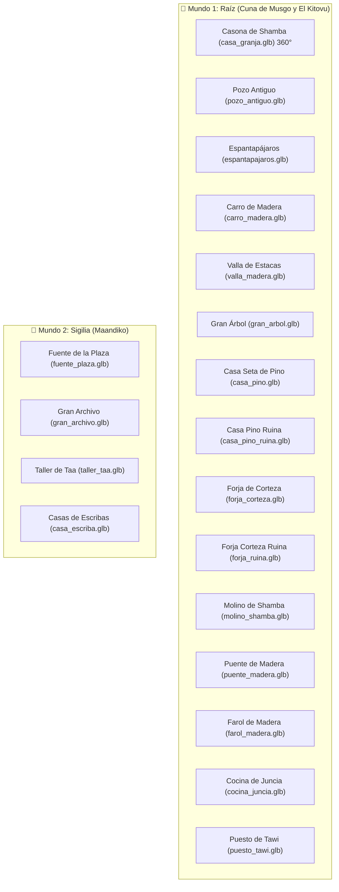

# Catálogo de Modelos 3D y Arquitectura HD-2D — Maisha

> **Bóveda de Obsidian**: [[LEEME]] · [[documentacion/decisiones|Decisiones de Diseño]] · [[documentacion/coordinacion|Coordinación Claude ⟷ Gemini]]
> **Pipeline Gráfico**: Blender 4.5.15 LTS (Headless procedural via `bpy`) $\rightarrow$ Godot 4.7.2 (GL Compatibility HD-2D).
> **Tags**: #maisha #hd2d #blender #arquitectura #modelos3d #gamedev

---

## 1. Filosofía HD-2D de Maisha (Modelo *Octopath Traveler*)

Maisha combina dos mundos para lograr su identidad visual única:
1. **Entidades Vivas (Personajes, Aldeanos, Criaturas y Jefes)**:
   - Sprites de pixel art artesanal colocados en posición vertical (*Y-Billboard*).
   - Volumen 3D mediante extrusión multicapa (`capas_fondo`) y sombreado de curvatura cilíndrica.
   - Mapas de normales (`*_n.png`) horneados para reaccionar físicamente a la luz del sol y a las luces cálidas nocturnas.
2. **Escenario y Arquitectura (Edificios, Casas, Puentes, Árboles y Farolas)**:
   - **Modelos 3D sólidos reales (`.glb`)** modelados procedimentalmente con Blender 4.5.
   - Paleta cromática oficial de Raíz y Sigilia con filtrado de píxel `NEAREST`.
   - Geometría completa de 360° con aleros, chimeneas, porches y proyección de sombras volumétricas dinámicas.

---

## 2. Paleta Oficial de Materiales Principled BSDF

| Material | Código Hex | Acabado (Roughness / Met) | Emisión de Luz | Uso Principal |
| :--- | :--- | :--- | :--- | :--- |
| `Mat_Maisha_Cuerpo` | `#FFE08A` | $0.50$ / $0.00$ | — | Piel dorada del brote de Maisha |
| `Mat_Corazon_Asili` | `#DF9022` | $0.20$ / $0.00$ | `#FFF8E8` ($2.2$) | Núcleo de Asili y llamas vivas |
| `Mat_Brote_Verde` | `#6FCF4F` | $0.40$ / $0.00$ | `#86EFAC` ($0.3$) | Brote y vegetación viva |
| `Mat_Arbol_Corteza` | `#452B1F` | $0.90$ / $0.00$ | — | Madera oscura del Gran Árbol y vigas |
| `Mat_Musgo_Hojas` | `#365314` | $0.60$ / $0.00$ | — | Tejados vegetales y copas |
| `Mat_Madera_Tablas` | `#854D0E` | $0.70$ / $0.00$ | — | Fachadas de casas y puentes |
| `Mat_Piedra_Plaza` | `#64748B` | $0.80$ / $0.00$ | — | Muros de mampostería y forjas |
| `Mat_Marmol_Sigilia` | `#E2E8F0` | $0.50$ / $0.00$ | — | Mármol blanco y columnas de Maandiko |
| `Mat_Teja_Cobriza` | `#C2410C` | $0.60$ / $0.00$ | — | Tejas a dos aguas de Sigilia |
| `Mat_Tinta_Sigilia` | `#312E81` | $0.30$ / $0.00$ | `#4F46E5` ($1.2$) | Frascos de tinta y vitrales de escribas |
| `Mat_Farol_Luz` | `#FDE047` | $0.20$ / $0.00$ | `#FEF08A` ($4.0$) | Linternas de farol y cristales |
| `Mat_Paja_Dorada` | `#D97706` | $0.80$ / $0.00$ | — | Fardos de paja, sombreros y cabezas de espantapájaros |
| `Mat_Madera_Tronco`| `#5C381E` | $0.75$ / $0.00$ | — | Troncos macizos de cabaña y estacas de valla |
| `Mat_Madera_Viga`  | `#78350F` | $0.70$ / $0.00$ | — | Vigas estructurales, marcos de puertas y ruedas de carro |
| `Mat_Piedra_Oscura`| `#334155` | $0.85$ / $0.00$ | — | Remates de chimenea y zócalos de mampostería pesada |

---

## 3. Catálogo de Arquitectura y Props 3D (`modelos/entorno/`)



### Detalle de Modelos Integrados:

1. **`casa_granja.glb` (El Kitovu - Mzee Shamba)**
   - Dimensiones: $3.8\times 2.6\times 4.0\text{ m}$.
   - Arquitectura: Casona de troncos macizos completa en 360°, zócalo de mampostería perimetral, tejado a dos aguas con aleros voladizos, porche frontal con postes y farolillo encendido, buhardilla iluminada en la cubierta superior, chimenea de piedra lateral y rueda de molino de agua hidráulica lateral con canaleta. Pared trasera cerrada con ventana y moldura de vigas (cero efecto papel al caminar por detrás).
   - Vinculado a: `casa_granja.png`.
2. **`pozo_antiguo.glb` (El Kitovu)**
   - Altura: $2.1\text{ m}$. Brocal circular de piedra labrada con agua cristalina interior, dos postes de madera verticales, eje giratorio con cuerda, cubo de madera suspendido y tejadillo a dos aguas de tablas.
   - Vinculado a: `pozo.png`.
3. **`espantapajaros.glb` (El Kitovu)**
   - Altura: $1.9\text{ m}$. Poste vertical con travesaño de brazos, cabeza de paja dorada con sombrero cónico rústico y poncho verde oliva de castor.
   - Vinculado a: `espantapajaros.png`.
4. **`carro_madera.glb` (El Kitovu)**
   - Dimensiones: $1.8\times 1.4\times 0.9\text{ m}$. Plataforma de tablas con barandillas laterales, varales de tiro frontales, eje de hierro forjado, dos ruedas con radios de madera y carga de fardos de heno.
   - Vinculado a: `carro.png`.
5. **`valla_madera.glb` (Universal)**
   - Dimensiones: $1.1\times 0.2\times 1.0\text{ m}$. Segmento modular de valla con dos postes cilíndricos rematados en punta biselada y dos travesaños horizontales macizos en 3D.
   - Vinculado a: `valla.png` y `cerca.png`.
6. **`casa_pino_ruina.glb` (Cuna de Musgo - Estado Inicial)**
   - Altura: $1.8\text{ m}$. Muros circulares derruidos a media altura, vigas rotas que asoman en ángulo, cubierta cónica de seta roja partida y desplomada sobre el terreno, con bloques de piedra y escombros esparcidos en 360°.
   - Vinculado a: `casa_seta.png` (cuando `frame == 0`) y `ruina_casa.png`.
7. **`forja_ruina.glb` (Cuna de Musgo - Estado Inicial)**
   - Altura: $1.6\text{ m}$. Horno de forja quebrado y agrietado, chimenea inclinada y desmoronada, tocón de soporte volcado, yunque de hierro caído en el suelo y escombros rocosos.
   - Vinculado a: `taller.png` (cuando `frame == 0`).
8. **`fuente_plaza.glb` (Sigilia - Plaza de Maandiko)**
   - Dimensiones: Diámetro $3.5\text{ m}$, Altura $2.1\text{ m}$. Pila octogonal exterior de mármol blanco, lámina de agua reflectante, pedestal central esculpido, taza superior y surtidor de agua.
   - Vinculado a: `fuente.png` y `fuente_plaza.png`.
9. **`gran_arbol.glb`**
   - Altura: $6.2\text{ m}$. Tronco colosal hueco con portal al Claro de Calma y copa de musgo escalonada.
   - Vinculado a: `gran_arbol.png`.
10. **`casa_pino.glb`**
    - Altura: $3.4\text{ m}$. Paredes de troncos, tejado cónico de seta carmesí, chimenea de piedra y farolillo exterior.
    - Vinculado a: `casa_seta.png` (cuando `frame >= 1`, tras ser reconstruida).
11. **`forja_corteza.glb`**
    - Altura: $2.8\text{ m}$. Horno de piedra volcánica con chimenea humeante, brasas encendidas y yunque de hierro.
    - Vinculado a: `taller.png` (cuando `frame >= 1`, tras ser reconstruida).
12. **`molino_shamba.glb`**
    - Altura: $3.5\text{ m}$. Cabaña de tablones con rueda hidráulica lateral de 16 palas para acequias.
    - Vinculado a: `molino.png`.
13. **`puente_madera.glb`**
    - Longitud: $3.2\text{ m}$. Tablones curvados con 6 postes de sujeción y pasamanos rústicos.
    - Vinculado a pasos de río y pasarelas.
14. **`farol_madera.glb`**
    - Altura: $2.4\text{ m}$. Poste de madera con brazo curvo y esfera de farol con iluminación omnidireccional cálida.
    - Vinculado a: `farol.png` y `farol_apagado.png`.
15. **`cocina_juncia.glb`**
    - Altura: $3.2\text{ m}$. Cabaña comunitaria con techo de musgo, chimenea y caldero frontal con fuego de Asili.
    - Vinculado a: `cocina.png`.
16. **`puesto_tawi.glb`**
    - Altura: $2.3\text{ m}$. Mostrador con 4 postes, toldo de tela a dos aguas y cajas con semillas doradas.
    - Vinculado a: `puesto.png`.
17. **`gran_archivo.glb`**
    - Altura: $5.2\text{ m}$. Escalinata de mármol, 4 columnas monumentales, frontón clásico y cúpula dorada.
    - Vinculado a: `gran_archivo.png`.
18. **`taller_taa.glb`**
    - Altura: $4.2\text{ m}$. Edificio urbano de dos plantas con planta baja de piedra, voladizo de madera y frasco de tinta de Sigilia.
    - Vinculado a: `taller_taa.png`.
19. **`casa_escriba.glb`**
    - Altura: $3.6\text{ m}$. Vivienda tradicional de Maandiko con muros encalados, balcón de madera y tejas cobrizas.
    - Vinculado a: `casa_escriba.png` y `casa_kalamu.png`.

---

## 4. Pipeline de Regeneración Automática

Para regenerar todos los modelos desde terminal:
```bash
/Applications/Blender.app/Contents/MacOS/Blender -b -P herramientas/blender/generador_3d_maisha.py
```
Los archivos `.glb` se exportan directamente a `modelos/entorno/`, `modelos/enemigos/` y `modelos/personajes/`, listos para ser consumidos automáticamente por [`espejo_hd2d.gd`](file:///Users/iinfafer/Proyectos/maisha-revision/scripts/mundo/hd2d/espejo_hd2d.gd).

---

## 5. Arquitectura del Agua HD-2D y Erradicación de Artefactos Negros

El agua en Maisha presentaba fugas de vacío y cortes oscuros en acequias y bordes de mapa causados por la discrepancia entre el plano del suelo ($y=0.0$) y la lámina de agua ($y=-0.35$). La solución implementada erradica cualquier artefacto negro:

1. **Talud Continuo en Vertex (`vertex()`)**:
   - El terreno se inclina de forma natural y progresiva hacia la cota del lecho acuático:
     $$\text{talud} = \text{smoothstep}(0.20, 0.56, \text{ag}) \times 0.28\text{ m}$$
   - Esto suprime la caída vertical en ángulo recto y conecta la orilla directamente con el fondo.
2. **Solape Continuo entre Capas (Eliminación de la Rendija)**:
   - Capa de tierra (`hundido < 0.5`): descarte retardado a `es_agua > 0.62` (la orilla sólida penetra bajo el agua).
   - Lámina de agua (`hundido > 0.5`): inicio temprano en `es_agua > 0.46` a $y=-0.28\text{ m}$.
   - Rango de solape de $[0.46, 0.62]$ donde la cámara de perspectiva ve tierra sumergida bajo el agua cristalina sin jamás exponer el vacío del motor.
3. **Lecho de Fondo Integrado (Transparencia Real)**:
   - En lugar de oscurecer arbitrariamente los píxeles perimetrales con multiplicadores oscuros, se mezcla con una tonalidad cálida de arena/guijarros de río:
     $$c = \text{mix}(\text{color\_lecho}, c, 0.60 + \text{profundidad} \times 0.40)$$
4. **Protección de Bordes de Mapa**:
   - El desvanecimiento perimetral (`d_borde`) nunca reduce la intensidad del agua por debajo de $0.88$ (evitando el oscurecimiento a $0.28$ que teñía de negro la acequia de El Kitovu).

