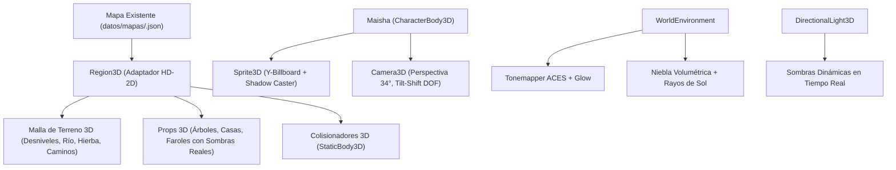

# Plan Maestro de Evolución Visual: De 2D Plano a HD-2D

Este documento establece la arquitectura y el plan de ejecución por etapas para transformar **Maisha** de un juego cenital 2D plano a un juego **HD-2D en espacio 3D real** (al estilo de *Octopath Traveler*, *Cult of the Lamb* y *Eastward*), conservando el 100% de la historia, música, pixel art y lógica narrativa.

---

## 1. Por qué HD-2D y no 3D Poligonal Puro

1. **Aprovechamiento total de los recursos existentes**: No se tira nada del arte dibujado. Los sprites de Maisha, aldeanos, criaturas, edificios y jefes se integran como *billboards* con proyección de sombras reales.
2. **Solución definitiva al aspecto «plano y antiguo»**: La profundidad angular de la cámara ($34^\circ$), las sombras alargadas, los desniveles físicos del terreno (ríos hundidos, puentes, colinas) y las luces omnidireccionales cálidas eliminan por completo la sensación de cuadrícula de 16-bit.
3. **Coexistencia con la IA constructora**: La lógica de mapas (`datos/mapas/*.json`), diálogos (`datos/dialogos/*.json`) y estados (`Estado`) se mantiene idéntica, permitiendo que la constructora siga avanzando contenido sin fricción.

---

## 2. Arquitectura del Motor HD-2D en Godot 4

### Componentes Clave:

1. **`Region3D` (Adaptador de Mapas)**:
   - Lee el mismo archivo `.json` de la región 2D.
   - Genera automáticamente el suelo 3D con texturas de hierba y camino.
   - Instancia las letras de objetos (`T`, `t`, edificios, faroles) como nodos `Sprite3D` con `billboard = BILLBOARD_FIXED_Y` y `alpha_cut = ALPHA_CUT_DISCARD` (para proyectar sombras).
   - Coloca fuentes de luz 3D reales (`OmniLight3D`) en cada farol.

2. **`Maisha3D` (Controlador del Personaje)**:
   - `CharacterBody3D` con gravedad y físicas de suelo.
   - Sprite3D animado con los 4 fotogramas existentes (andar, correr, reposo, daño, celebrar).
   - Movimiento en el plano $XZ$ y salto vertical ($Y$).

3. **Cámara e Iluminación Cinematográfica**:
   - `Camera3D` con perspectiva angular ($34^\circ$) y seguimiento suave.
   - `WorldEnvironment` con mapeado de tonos ACES, resplandor suave y niebla volumétrica.
   - Sol direccional que rota según `Reloj` (atardecer dorado, noche mística, mañana clara).

---

## 3. Plan de Ejecución por Etapas

### Etapa 1: Prototipo y Demo Jugable ✅ *(Completada en `experimento/prototipo-visual`)*
- [x] Diorama con 3 niveles de altura (río, puente, terraza).
- [x] Maisha controlable con animaciones y sombras reales.
- [x] Diálogo interactivo con Pino (retrato, bocadillo y texto).
- [x] Combate HD-2D: Golpe de cetro (J) y semillas explosivas (K) con físicas y retroceso 3D.
- [x] Ciclo día/noche y alternancia instantánea con tecla 3.
- [x] Rama remota y comparativa visual interactiva.

### Etapa 2: Migración del Primer Entorno Real (`Cuna de Musgo HD-2D`)
- [ ] Crear `scripts/mundo/region_3d.gd` que interprete `datos/mapas/cuna_de_musgo.json`.
- [ ] Reemplazar el fondo plano de la aldea por el pueblo en 3D con sus 4 casas reconstruidas y el Gran Árbol.
- [ ] Aldeanos en sus puestos (Bibi, Corteza, Pino, Juncia, Tawi) con sus animaciones y gestos.

### Etapa 3: Sistema de Combate y Zonas Corruptas en 3D
- [ ] Adaptar las raíces de piedra de Giza para que broten del suelo tridimensional al cruzar el umbral.
- [ ] Petrinos y enemigos adaptados a navegación 3D sobre el terreno.
- [ ] Efectos de purga con ondas de luz que devuelven el color al suelo y a los árboles.

### Etapa 4: Pulido de Materiales y Shaders
- [ ] Shader de agua con reflejos especulares para ríos y lagos.
- [ ] Partículas 3D de hojas mecidas por el viento y polen en rayos de sol.
- [ ] Integración con el menú de pausa y la mochila en pantalla completa.
