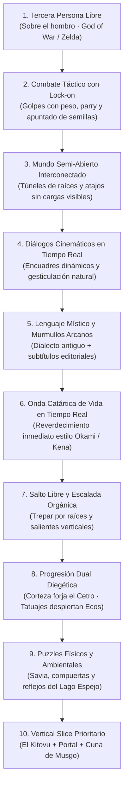

# 📜 PLAN MAESTRO 3D AAA: MAISHA (DOCUMENTO DE DISEÑO DEFINITIVO)

> **Resultado Oficial del Grilling (`/grill-me`)**: Alineación completa y sin ambigüedades sobre los 10 pilares fundamentales del juego entre el creador (**Iam**), la directora de arte y mapeado (**Gemini**) y el modelador de Blender y lógica (**Claude Code**).

---

## 🏛️ LOS 10 PILARES ARQUITECTÓNICOS ACORDADOS

---

### 1️⃣ Cámara y Perspectiva
* **Tercera persona libre sobre el hombro** (*God of War / Zelda: Tears of the Kingdom / Shadow of the Colossus*).
* Permite contemplar la escala ciclópea de las ruinas y raíces milenarias, con control total del jugador sobre el ángulo de visión (ratón / stick derecho).
* Escenarios con límites ambientales naturales (acantilados, zarzales de Giza impenetrables, desfiladeros brumosos).

---

### 2️⃣ Sistema de Combate y Ritmo
* **Combate táctico con fijación de objetivo (*Lock-on*)**:
  * Golpes de Cetro con peso e inercia (*hit-stop* sutil y crujido de madera viva).
  * Esquiva rodando en el suelo con invulnerabilidad precisa (*i-frames*).
  * Parada táctica con el Cetro (*parry* de luz de Asili) que desestabiliza a los enemigos petrificados.
  * Modo de apuntado libre sobre el hombro para lanzar semillas mágicas con precisión (semillas ígneas, explosivas y sanadoras).

---

### 3️⃣ Estructura del Mundo y Transiciones
* **Mundo semi-abierto interconectado sin pantallas de carga artificiales** (*God of War 2018 / Jedi: Fallen Order*).
* Regiones compactas pero con altísima densidad atmosférica.
* Conexiones orgánicas mediante pasadizos de raíces retorcidas, cavernas de micelio y grietas de roca que cargan el siguiente bioma en segundo plano.
* Atajos físicos que se desbloquean al purificar áreas (escaleras de cuerda de Mbuzi, compuertas de río abiertas por Bata).

---

### 4️⃣ Diálogos e Interacción Cinemática
* Al hablar con un NPC, la cámara se reubica suavemente en un **plano cinemático sobre el hombro en tiempo real** (*in-engine*).
* Los personajes gesticulan con naturalidad (Shamba ajustándose sus gafas de botánico, Bata apoyándose en su pala rúnica, Pino señalando con entusiasmo).
* Subtítulos limpios y editoriales en la parte inferior, manteniendo la inmersión viva.

---

### 5️⃣ Diseño Vocal y Audio
* **Dialecto místico ancestral y murmullos expresivos únicos** (*Shadow of the Colossus / Zelda / Hollow Knight*).
* Cada criatura tiene un timbre acústico inolvidable:
  * Mzee Shamba: Murmullos carrasposos, educados y sabios de anciano.
  * Maisha: Entonaciones etéreas y cálidas.
  * Bata: Tonalidades guturales profundas y resonantes de río.
* Subtítulos cinematográficos completos en español.

---

### 6️⃣ Purificación del Mundo en Tiempo Real
* **Onda expansiva catártica de vida** (*Okami / Kena / Ghost of Tsushima*).
* Al vencer una infestación de Giza o golpear un Nudo con el Latido de Asili:
  * Una onda de luz dorada barre la bruma y la ceniza en un radio expansivo.
  * La roca muerta se quiebra, alfombras de musgo aterciopelado y flores silvestres brotan en segundos ante la cámara.
  * El sol atraviesa las nubes con un estruendo telúrico y una fanfarria armónica sobrecogedora.

---

### 7️⃣ Movilidad y Plataformeo Vertical
* **Salto libre con peso** mediante la barra espaciadora.
* **Escalada orgánica**: Maisha puede trepar por muros de enredaderas y raíces rugosas marcadas.
* Agarre de cornisas y salientes para alcanzar secretos y ruinas en altura (*Zelda / Shadow of the Colossus*).

---

### 8️⃣ Progresión Dual Diegética en el Mundo
* **La Forja del Cetro (Corteza)**:
  * El herrero forja físicamente nuevas cabezas de báculo (cabezas cortantes, púas de choque telúrico, cristal de escarcha) entregándole minerales raros del entorno.
* **Los Tatuajes Mnemotécnicos (El Despertar de Maisha)**:
  * Al meditar en los santuarios y recuperar los 9 Ecos, los tatuajes grabados en el cuerpo de Maisha despiertan progresivamente con oro líquido, desbloqueando nuevas ondas del Latido y pasivas de Asili.

---

### 9️⃣ Rompecabezas Ambientales Físicos
* Puzzles integrados en el ecosistema de Asili (*Zelda / God of War*):
  * Redirección de canales de savia dorada para reactivar antiguos mecanismos.
  * Quemar zarzas de Giza con semillas ígneas.
  * Hacer palanca en compuertas de raíz gigantescas con el Cetro.
  * **El misterio del Lago Espejo**: Pasarelas y templos invisibles que solo existen y se pueden pisar cuando el agua refleja el cielo.

---

### 🔟 El Primer Hito de Producción: Vertical Slice Prioritario
* **Alcance del Vertical Slice**:
  1. **El Kitovu 3D**: Despertar en el cráter, árbol seco, encuentro con Mzee Shamba bípedo con gafas en su huerto y casona 360°, y primer combate contra un brote de Giza.
  2. **El Paso del Portal de Raíz**: Túnel de transición sin cargas con niebla volumétrica.
  3. **Cuna de Musgo 3D**: La plaza del Gran Árbol, la Forja de Corteza, la Cabaña de Pino, y la purificación catártica del primer gran nudo de corrupción.
