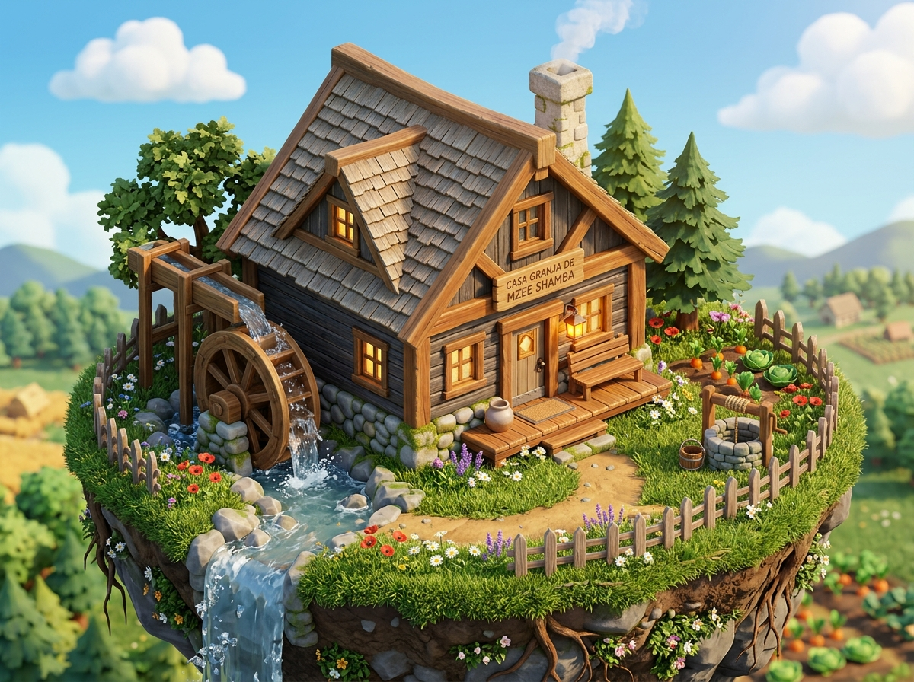

# 🏡 FICHA DE REFERENCIA 3D: CASA GRANJA DE MZEE SHAMBA

- **Elemento**: Casona de Mzee Shamba (Granja Tutorial)
- **Archivo Destino**: `modelos/entorno/casa_granja.glb`
- **Modelador Asignado**: Claude Code (vía Blender `bpy`)
- **Estilo**: Arquitectura rústica sólida de 360° (diorama cálido con molino y acequia viva)

---

## 📏 DIMENSIONES Y COMPOSICIÓN
- **Dimensiones Generales**: Frente $5.0\text{ m}$, Fondo $4.2\text{ m}$, Altura cumbrera $4.8\text{ m}$.
- **Zócalo Inferior**: Mampostería de piedra de río con mortero de arcilla (altura $0.4\text{ m}$).
- **Muros Principales**: Troncos horizontales solapados en las cuatro esquinas (delanteros, traseros y laterales).
- **Tejado a Dos Aguas**: Tablones de madera de cedro escalonados con alerones pronunciados.
- **Chimenea**: Bloque de piedra caliza de $0.7\times 0.7\text{ m}$ empotrado en el tejado, con tiro superior abierto.
- **Rueda Hidráulica**: Rueda de molino de $1.6\text{ m}$ de diámetro en el lateral izquierdo, conectada con canaleta de agua. Malla separada para posibilitar rotación en Godot.
- **Fachada Trasera**: Completamente cerrada, con ventana pequeña y cobertizo/leñera adosada.

---

## 🎨 PALETA DE MATERIALES (HEX)
| Material | Color HEX | Roughness | Metallic | Emission | Notas |
| :--- | :--- | :--- | :--- | :--- | :--- |
| `madera_troncos` | `#855430` | 0.75 | 0.0 | - | Madera cálida de pino |
| `madera_tejado` | `#ab5e35` | 0.80 | 0.0 | - | Tablones de cedro rojizo |
| `piedra_zocalo` | `#5e636b` | 0.85 | 0.0 | - | Mampostería gris fluvial |
| `chimenea_caliza`| `#828894` | 0.90 | 0.0 | - | Piedra porosa clara |
| `luz_ventana` | `#ffcc33` | 0.20 | 0.0 | 1.8 | Resplandor acogedor |
| `rueda_molino` | `#4a301c` | 0.70 | 0.0 | - | Madera oscura humedecida |

---

## ⚙️ INSTRUCCIONES DE EXPORTACIÓN
1. Asegurar que las normales apunten hacia afuera y activar `Auto Smooth` / `Sharp Edges` en las aristas de los troncos.
2. La rueda del molino debe tener su centro de pivote en su eje para permitir rotar con `rotate_x` o `rotate_z`.
3. Exportar con coordenadas $Z$-arriba (Blender) convertidas a $Y$-arriba (Godot `.glb`).
