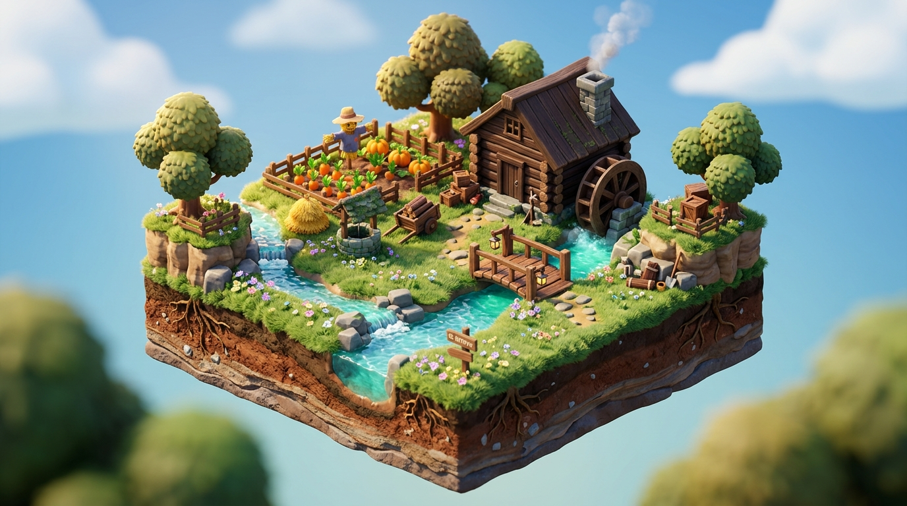

# 🗺️ FICHA DE REFERENCIA 3D: DIORAMA EL KITOVU

- **Elemento**: Escenario Tutorial El Kitovu (Granja de Mzee Shamba)
- **Escena Destino**: `escenas/mundo_3d/kitovu_3d.tscn`
- **Responsable de Mapeado y Shaders**: Gemini
- **Modelos Involucrados (Claude)**: `casa_granja.glb`, `pozo_antiguo.glb`, `espantapajaros.glb`, `carro_madera.glb`, `valla_madera.glb`.

---

## 📐 ESTRUCTURA DEL DIORAMA EN GODOT 4.7
1. **Terreno Modular**:
   - Plataforma diorama con base de roca y capas de tierra fértil.
   - Césped volumétrico con shader de dispersión que se dobla suavemente al paso de Maisha.
2. **Sistema Hidráulico (Acequia & Río)**:
   - Acequia con canal de madera que desciende desde la colina norte hacia la rueda del molino y desemboca en el estanque de pesca.
   - Sombreador de agua con profundidad cáustica, reflejos celestes y espuma en los bordes.
3. **Puntos de Interés de la Zona**:
   - **Norte**: Entrada al sendero bloqueada por maleza/derrumbe.
   - **Centro**: La Casona de Shamba, pozo antiguo y porche con farol.
   - **Este**: Huerto vallado con zanahorias y espantapájaros.
   - **Sur**: Acequia con puente de madera y orilla con juncos.
4. **Iluminación y Atmósfera**:
   - `DirectionalLight3D` dorada matinal (35° elevación).
   - `WorldEnvironment` con niebla suave en la lejanía y tilt-shift de maqueta.
   - Partículas 3D de polen flotante y hojas caídas.
