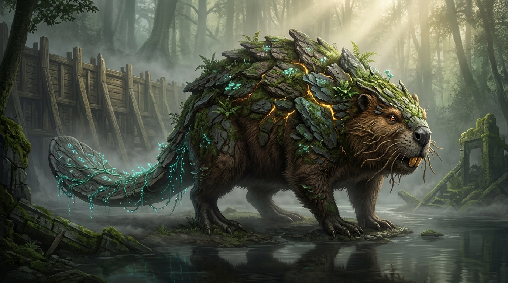

# 🌊 FICHA DE REFERENCIA 3D: BATA (EL ARQUITECTO ANCESTRAL DE LAS CORRIENTES)



- **Elemento**: Bata, Espíritu Guardián Fluvial y Arquitecto de las Corrientes
- **Archivo Destino**: `modelos/personajes/bata_castor_mitico.glb`
- **Modelador Asignado**: Claude Code (vía Blender `bpy`)
- **Naturaleza del Personaje**: **Criatura Mítica y Sagrada de los Ríos de Asili**. En el tono de alta fantasía solemne (inspiración: *Princess Mononoke*, *Shadow of the Colossus*, *Elden Ring*, *God of War*), Bata no es un roedor ordinario, sino una bestia totémica colosal venerada como el espíritu que equilibra el flujo del agua y las presas que protegen las raíces del mundo.
- **Papel Narrativo**: Idéntico al guion original. Custodia la barca, el paso fluvial y el dique ante la corrupción de Giza.

---

## 📏 PROPORCIONES Y ANATOMÍA MÍSTICA
- **Escala y Masa**: Bestia cuadrúpeda imponente, longitud aproximada de $2.80\text{ m}$ desde el hocico hasta la punta de la cola, y una altura a la cruz de $1.25\text{ m}$.
- **Carapacho de Corteza y Lajas**:
  - A lo largo de la columna vertebral y los hombros crecen placas de madera petrificada y lajas de pizarra fluvial cubiertas de musgo oscuro, hongos parásitos luminiscentes y pequeños brotes de helecho.
  - Entre las comisuras de las placas palpitan sutiles vetas de savia dorada (remanente de la energía viva de Asili).
- **Cola Rúnica Petrificada**:
  - Su cola no es de escamas animales comunes; es una gran pala plana que evoca una losa de piedra milenaria tallada o un remo sagrado petrificado.
  - Grabada con antiguos glifos rúnicos que canalizan las corrientes y gotean hebras de algas bioluminiscentes turquesas.
- **Rostro y Mirada Sabia**:
  - Hocico arcaico y noble con expresión solemne y melancólica.
  - Grandes incisivos cincelados que parecen cuarzo ámbar o roca fosilizada translúcida, capaces de tallar troncos de secuoya sagrada.
  - Bigotes sensoriales que son finos zarcillos de raíz sensible.
  - Ojos profundos de ámbar líquido con un resplandor cálido interior.
- **Patas Palmeadas de Raíz**:
  - Robustas patas delanteras con garras de madera petrificada para moldear presas y lechos de roca. Patas traseras palmeadas con membranas gruesas.

---

## 🎨 PALETA DE MATERIALES (HEX)
| Material | Color HEX | Roughness | Metallic | Emission | Función |
| :--- | :--- | :--- | :--- | :--- | :--- |
| `pelaje_turba` | `#2b241d` | 0.85 | 0.0 | - | Pelaje grueso e impermeable de tonos tierra profunda |
| `placas_corteza_roble` | `#403023` | 0.90 | 0.0 | - | Placas de corteza petrificada en hombros y lomo |
| `lajas_pizarra_rio` | `#454b4d` | 0.70 | 0.1 | - | Placas minerales de pizarra fluvial |
| `musgo_humedo` | `#334a28` | 0.80 | 0.0 | - | Capa de musgo y líquenes sobre el lomo |
| `cola_runica_piedra` | `#393e42` | 0.65 | 0.1 | - | Cola petrificada con tacto de piedra pulida por el río |
| `runas_algas_cyan` | `#2de3c4` | 0.30 | 0.0 | 1.4 | Glifos rúnicos y algas bioluminiscentes en la cola |
| `incisivos_ambar` | `#d4882e` | 0.25 | 0.0 | 0.8 | Dientes de cuarzo ámbar translúcido |
| `ojos_ambar_sabio` | `#f0a830` | 0.20 | 0.0 | 1.2 | Ojos luminosos con resplandor cálido |
| `vetas_savia_asili` | `#f5c238` | 0.20 | 0.0 | 1.5 | Grietas en el lomo con energía dorada latente |

---

## 🦴 ESQUELETO Y RIGGING PARA BLENDER
```
root (suelo, y=0.0)
 └─ pelvis (centro de masa animal, y=0.65m)
     ├─ spine_01 -> spine_02 -> chest -> neck -> head
     │    ├─ jaw (mandíbula inferior con incisivos)
     │    ├─ whiskers_L / whiskers_R (zarcillos sensoriales)
     │    └─ eyes
     ├─ shoulder_L/R -> arm_L/R -> forearm_L/R -> paw_front_L/R (con garras)
     ├─ tail_01 -> tail_02 -> tail_03 -> tail_paddle (huesos de cola para ondulación en nado y golpe de dique)
     └─ hip_L/R -> leg_L/R -> shin_L/R -> paw_back_L/R (patas traseras palmeadas)
```

---

## 🎬 ANIMACIONES CLAVE
1. `idle_solemne`: Respiración pesada y solemne con ondulación leve de la cola y destello rítmico de las runas.
2. `observar_maisha`: Gira la cabeza lentamente con respeto ancestral hacia el Espíritu de la Vida.
3. `golpe_de_cola`: Levanta la pesada cola rúnica y azota el agua o el suelo para dispersar la bruma de Giza o abrir compuertas.
4. `tallar_presa`: Incisivos clavándose rítmicamente en madera antigua.
5. `nadar_inmersion`: Deslizamiento majestuoso y pesado bajo las aguas del río.
