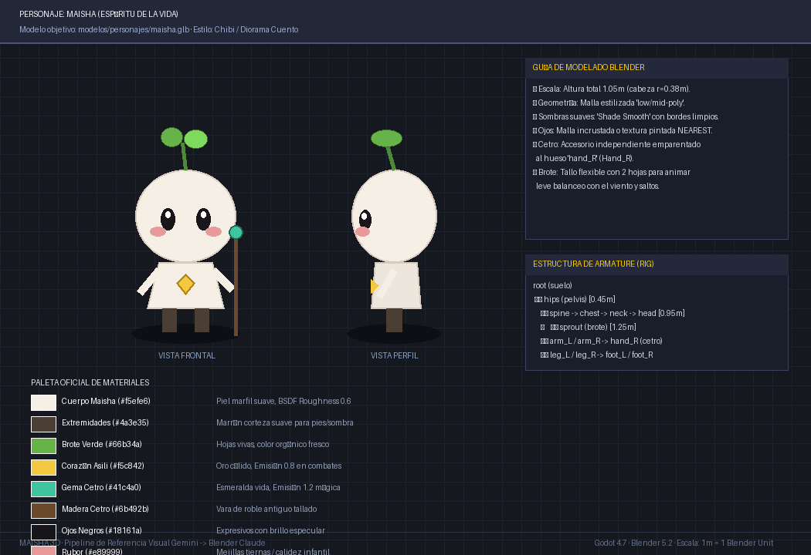

# 🌿 FICHA DE REFERENCIA 3D: MAISHA (PROTAGONISTA)



- **Elemento**: Maisha, Espíritu de la Vida
- **Archivo Destino**: `modelos/personajes/maisha.glb`
- **Modelador Asignado**: Claude Code (vía Blender `bpy`)
- **Estilo**: Chibi estilizado / Diorama de cuento (curvas suaves, silueta limpia y expresiva)

---

## 📏 PROPORCIONES Y DIMENSIONES
- **Altura Total**: $1.05\text{ m}$ (1.05 Blender Units).
- **Cabeza**: Esfera $r = 0.38\text{ m}$ ligeramente achatada en $Y$ ($scale = (1.05, 0.95, 0.95)$).
- **Ojos**: Óvalos negros con brillo blanco superior y rubor ovalado rosado bajo los ojos.
- **Brote de la Cabeza**: Tallo cilíndrico delgado de $0.18\text{ m}$ con dos hojas curvadas.
- **Torso**: Cono truncado de base $0.26\text{ m}$ y remate superior $0.18\text{ m}$, altura $0.45\text{ m}$.
- **Corazón de Asili**: Gema en relieve incrustada en el pecho con brillo dorado.
- **Extremidades**: Brazos y piernas simplificados con sombreado suave.
- **Cetro de Raíz**: Vara de roble con gema verde en la parte superior. Emparentado a `Hand_R`.

---

## 🎨 PALETA DE MATERIALES (HEX)
| Material | Color HEX | Roughness | Metallic | Emission | Notas |
| :--- | :--- | :--- | :--- | :--- | :--- |
| `maisha_cuerpo` | `#f5efe6` | 0.60 | 0.0 | - | Piel aterciopelada marfil cálido |
| `ojos_negros` | `#18161a` | 0.20 | 0.0 | - | Ojos brillantes |
| `rubor` | `#e89999` | 0.70 | 0.0 | - | Mejillas cálidas |
| `brote_verde` | `#66b34a` | 0.50 | 0.0 | - | Hojas tiernas |
| `corazon_asili` | `#f5c842` | 0.30 | 0.1 | 0.8 | Oro cálido palpitante |
| `cetro_madera` | `#6b492b` | 0.80 | 0.0 | - | Madera viva |
| `cetro_gema` | `#41c4a0` | 0.20 | 0.1 | 1.2 | Gema mágica de esmeralda |

---

## 🦴 ESQUELETO Y ANIMACIONES PARA BLENDER
### Jerarquía de Huesos:
```
root (suelo, z=0)
 └─ hips (pelvis, z=0.45)
     ├─ spine -> chest -> neck -> head (z=0.95)
     │    └─ sprout (brote, z=1.25)
     ├─ arm_L -> hand_L
     ├─ arm_R -> hand_R (hueso con socket para Cetro)
     ├─ leg_L -> foot_L
     └─ leg_R -> foot_R
```

### Animaciones Necesarias:
1. `reposo` (Idle): Respiración sutil en torso y leve mecido del brote (30 frames).
2. `caminar` (Walk): Bamboleo rítmico y paso alegre (24 frames).
3. `correr` (Run): Inclinación hacia adelante con brazos oscilando (18 frames).
4. `lanzar_magia`: Alzado del cetro con destello en la gema y brote erguido (20 frames).
