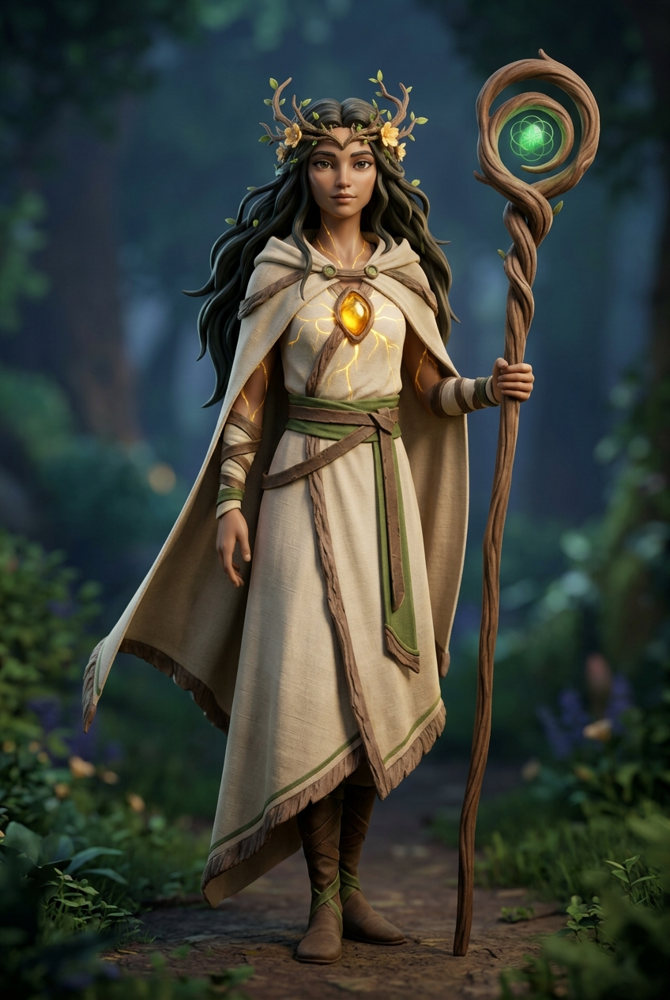

# 🌿 FICHA DE REFERENCIA 3D: MAISHA (VERSIÓN ADULTA / MADURA)



- **Elemento**: Maisha, Guardiana Ancestral y Espíritu de la Vida
- **Archivo Destino**: `modelos/personajes/maisha_adulto.glb`
- **Modelador Asignado**: Claude Code (vía Blender `bpy`)
- **Estilo**: 3D estilizado maduro / fantasía poética (inspiración: *Kena: Bridge of Spirits*, *Princess Mononoke*, *Zelda: Breath of the Wild*)
- **Evolución**: Abandono completo del estilo infantil/chibi; adopción de proporciones esbeltas, porte noble, serenidad y elegancia mística.

---

## 📏 PROPORCIONES Y ANATOMÍA ADULTA
- **Estatura Total**: $1.68\text{ m} - 1.72\text{ m}$ (proporción de 6.5 a 7 cabezas de altura).
- **Cabeza y Rostro**:
  - Proporción estilizada adulta ($h \approx 0.24\text{ m}$).
  - Pómulos suaves, expresión serena y sabia, ojos almendrados expresivos y profundos.
  - Corona vegetal sutil integrada: ramas finas de madera viva entrelazadas con hojas frescas (en lugar de un brote caricaturesco).
- **Torso y Vestimenta**:
  - Silueta esbelta con túnica asimétrica de lino natural en tonos arena y marfil (#eae3d2).
  - Capa corta o pañuelo de viaje al hombro con caída orgánica.
  - Cinturón rústico de cuero oscuro con frascos de semillas y runas talladas.
- **Corazón de Asili**:
  - Gema incrustada en el esternón con oro líquido resplandeciente ($Roughness = 0.25$, $Emission = 1.2$).
  - Vetas sutiles de savia dorada que se ramifican brevemente hacia los hombros.
- **Extremidades**:
  - Piernas esbeltas con botas o vendajes de cuero suave hasta media pantorrilla ($h \approx 0.85\text{ m}$).
  - Brazos ágiles con brazaletes de cuerda o madera tallada en antebrazos.
- **Cetro de Raíz**:
  - Bastón alto de caminante ($1.78\text{ m}$ de longitud) de roble antiguo retorcido, con una espiral en la punta que abraza una semilla de vida esmeralda brillante.

---

## 🎨 PALETA DE MATERIALES (HEX)
| Material | Color HEX | Roughness | Metallic | Emission | Función |
| :--- | :--- | :--- | :--- | :--- | :--- |
| `maisha_piel_adulta` | `#ede5d8` | 0.55 | 0.0 | - | Piel marfil cálida |
| `tunica_lino` | `#d8cfbe` | 0.80 | 0.0 | - | Tejido natural rústico |
| `capa_viajero` | `#4a573d` | 0.85 | 0.0 | - | Verde musgo apagado |
| `cuero_cinturon` | `#422b19` | 0.70 | 0.0 | - | Cuero curtido con hebilla de bronce |
| `corona_vegetal` | `#528c38` | 0.45 | 0.0 | - | Hojas vivas y ramas tiernas |
| `corazon_asili_oro` | `#f0be35` | 0.25 | 0.1 | 1.4 | Luz cálida sagrada de vida |
| `cetro_madera_vieja`| `#543c25` | 0.85 | 0.0 | - | Madera nudosa de raíz |
| `gema_vida_cetro` | `#35b894` | 0.15 | 0.0 | 1.8 | Esmeralda mágica de sanación |

---

## 🦴 ESQUELETO Y RIGGING PARA BLENDER
```
root (suelo, y=0.0)
 └─ hips (pelvis, y=0.88m)
     ├─ spine_01 -> spine_02 -> chest -> neck -> head (y=1.52m)
     │    ├─ jaw / eyes
     │    └─ crown_branches (huesos secundarios para follaje)
     ├─ shoulder_L -> arm_L -> forearm_L -> hand_L
     ├─ shoulder_R -> arm_R -> forearm_R -> hand_R (socket para Cetro)
     ├─ cape_L / cape_R (huesos de capa para mecido con viento)
     └─ thigh_L/R -> calf_L/R -> foot_L/R -> toe_L/R
```
