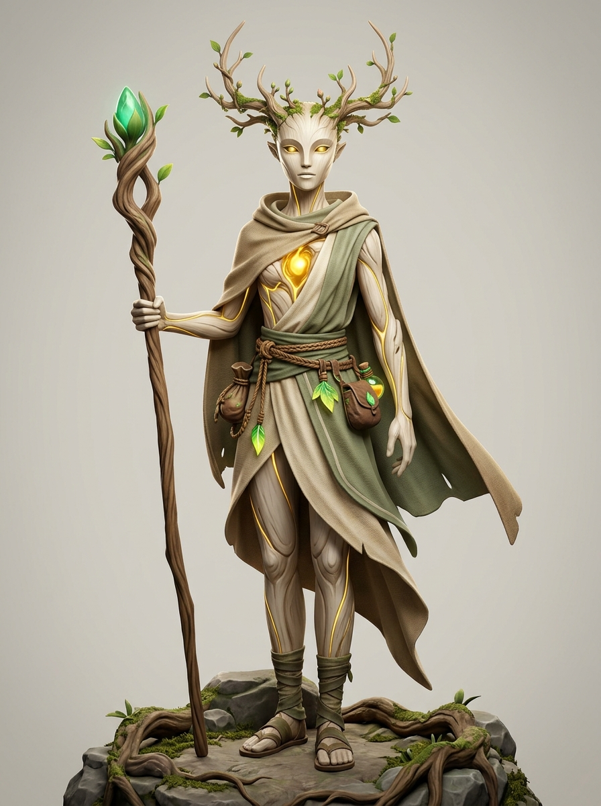

# 🌿 FICHA DE REFERENCIA 3D: MAISHA (SER MÍSTICO · ESPÍRITU DE LA VIDA)



- **Elemento**: Maisha, Espíritu Ancestral de la Vida / Guardián de Asili
- **Archivo Destino**: `modelos/personajes/maisha.glb`
- **Modelador Asignado**: Claude Code (vía Blender `bpy`)
- **Naturaleza del Personaje**: **Ser Místico Andrógino / Sin Género Humano**. Ni hombre ni mujer: una entidad espiritual ancestral nacida de la madera viva, la savia de Asili y el lino antiguo.
- **Estilo**: 3D estilizado místico y poético (inspiración: *Espíritu del Bosque de Mononoke*, *Guardianes de Zelda*, *Kena spirits*, *Journey*).

---

## 📏 PROPORCIONES Y ANATOMÍA MÍSTICA
- **Estatura y Silueta**: $1.72\text{ m}$ (proporción esbelta y grácil de 7 cabezas de altura).
- **Cuerpo Andrógino**: Torso neutro y estilizado sin anatomía de género humano. Construido a partir de madera clara pulida, marfil vegetal y tejido muscular de lianas y savia.
- **Rostro de Espíritu**:
  - Serenidad ancestral que evoca una máscara ceremonial tallada en madera suave clara o porcelana viva.
  - Ojos profundos y luminosos como gemas oscuras con destello dorado interior.
  - Cero rasgos humanos femeninos o masculinos marcados; pura elegancia etérea.
- **Astas y Corona de Madera Viva**:
  - En la parte superior de la cabeza se ramifican astas finas y delicadas de madera viva con brotes de hojas verdes frescas.
- **Atuendo de Viajero Sagrado**:
  - Túnica y capa asimétrica de lino rústico en tonos arena y marfil (#eae3d2) con remates de verde musgo (#4a573d).
  - Cinturón de cuero vegetal con bolsas de semillas y runas de Asili talladas.
- **Corazón de Asili**:
  - Cavidad sagrada en el esternón con núcleo de oro líquido puro resplandeciente ($Roughness = 0.2$, $Emission = 1.5$).
  - Vetas luminosas doradas de energía vital que recorren el pecho y los brazos.
- **Cetro de Raíz**:
  - Vara alta de roble antiguo retorcido ($1.80\text{ m}$) con una espiral en la punta que abraza una semilla de vida esmeralda palpitante.

---

## 🎨 PALETA DE MATERIALES (HEX)
| Material | Color HEX | Roughness | Metallic | Emission | Función |
| :--- | :--- | :--- | :--- | :--- | :--- |
| `cuerpo_espiritu` | `#ede5d8` | 0.50 | 0.0 | - | Madera clara pulida / marfil vegetal |
| `tunica_lino` | `#d8cfbe` | 0.80 | 0.0 | - | Lino natural rústico |
| `capa_musgo` | `#4a573d` | 0.85 | 0.0 | - | Verde musgo apagado |
| `astas_madera_viva`| `#634932` | 0.75 | 0.0 | - | Ramas tiernas de madera viva |
| `hojas_corona` | `#58943e` | 0.40 | 0.0 | - | Hojas verdes frescas |
| `corazon_asili_oro` | `#f5c238` | 0.20 | 0.1 | 1.6 | Oro líquido palpitante de vida |
| `vetas_savia_dorada`| `#ffd766` | 0.20 | 0.0 | 1.2 | Vetas de energía en el torso |
| `cetro_madera` | `#523b24` | 0.85 | 0.0 | - | Madera antigua nudosa |
| `gema_cetro_verde` | `#35b894` | 0.15 | 0.0 | 1.8 | Semilla mágica de sanación |

---

## 🦴 ESQUELETO Y RIGGING PARA BLENDER
```
root (suelo, y=0.0)
 └─ hips (pelvis andrógina, y=0.90m)
     ├─ spine_01 -> spine_02 -> chest -> neck -> head (y=1.54m)
     │    ├─ antlers_L / antlers_R (huesos de ramas vivas)
     │    └─ eyes_glow
     ├─ shoulder_L -> arm_L -> forearm_L -> hand_L
     ├─ shoulder_R -> arm_R -> forearm_R -> hand_R (socket para Cetro)
     ├─ cloak_01 -> cloak_02 (huesos de capa para mecido suave)
     └─ thigh_L/R -> calf_L/R -> foot_L/R
```
