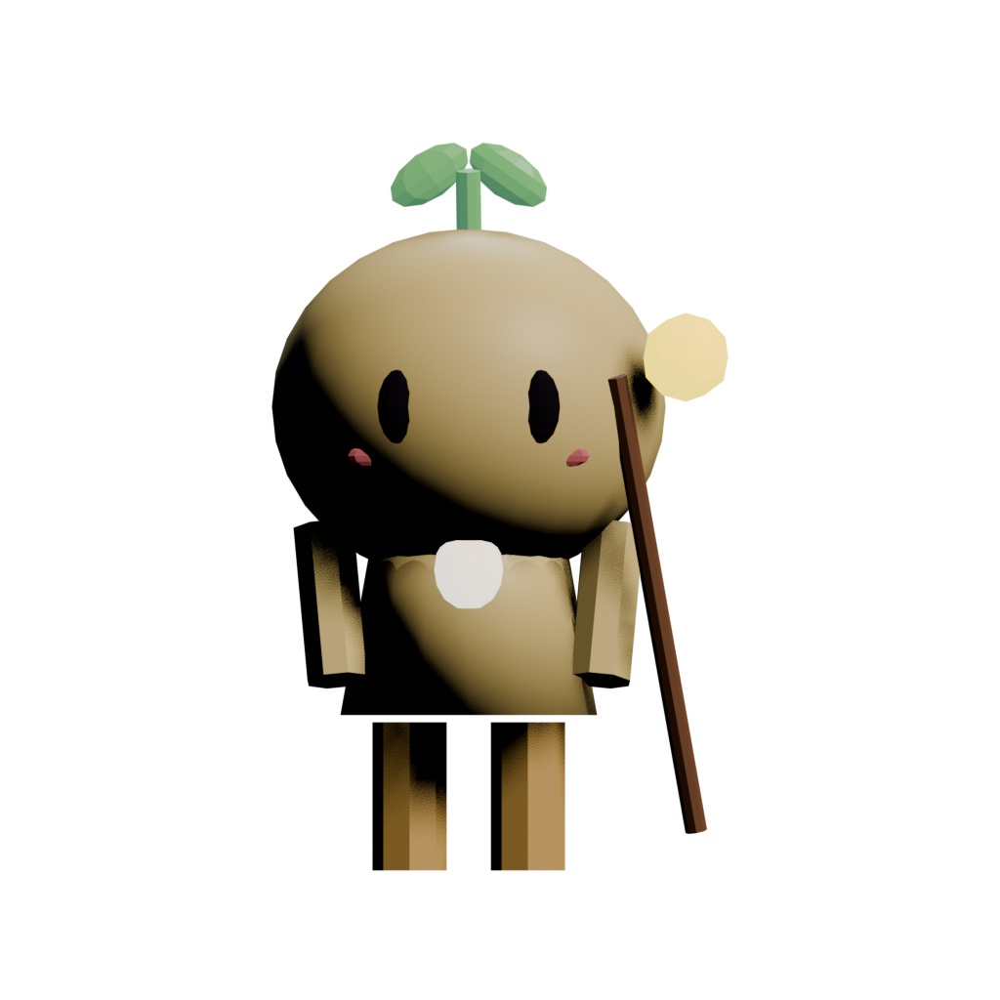
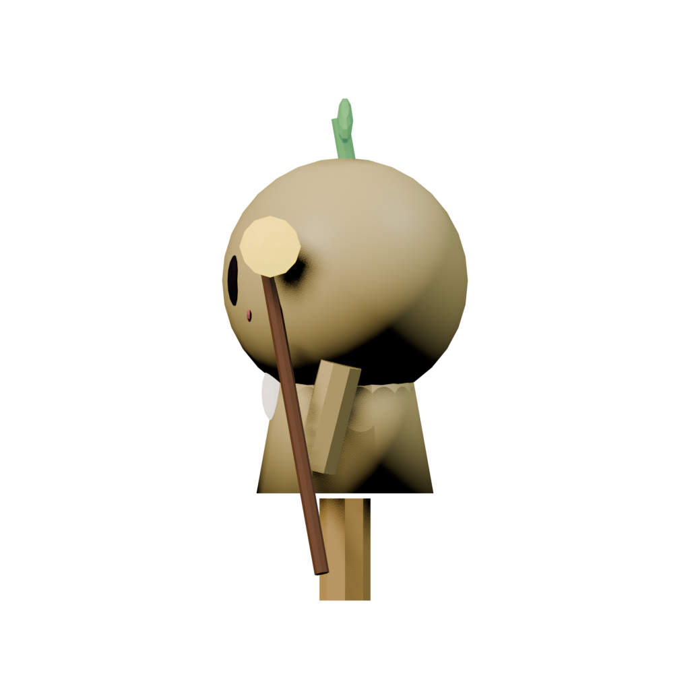
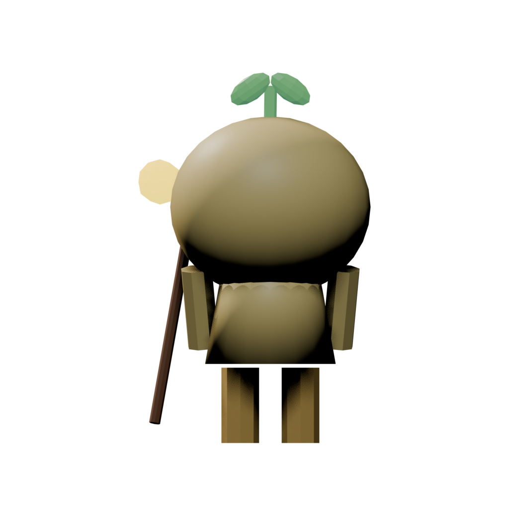
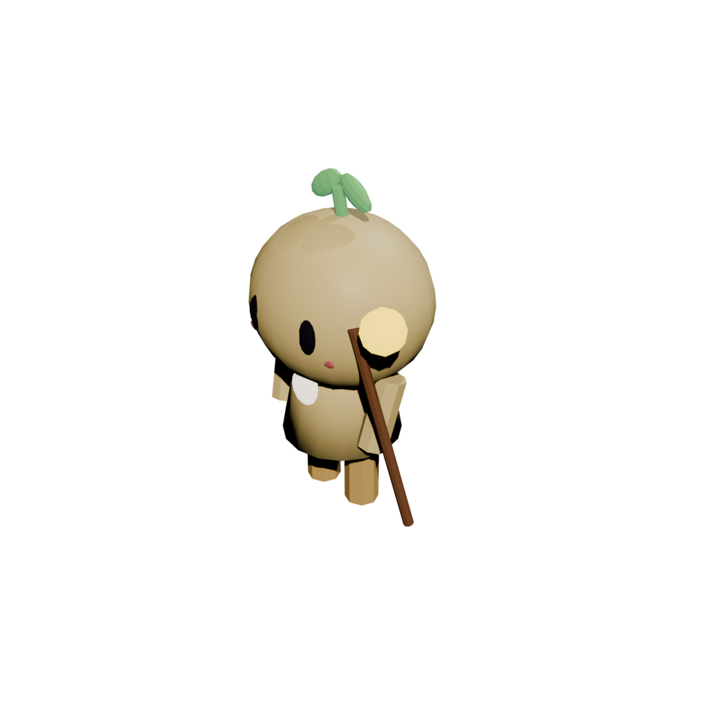

# 🌿 FICHA DE REFERENCIA 3D: MAISHA (SER MÍSTICO HUMANIZADO · EL GUARDIÁN DE LA MEMORIA)

- **Elemento**: Maisha, Espíritu de la Vida y Custodio del Olvido
- **Archivo Destino**: `modelos/personajes/maisha.glb`
- **Modelador Asignado**: Claude Code (vía Blender `bpy`)
- **Dirección Creativa Oficial (Feedback Directo de Iam)**:
  - **Más humanizado y cercano al público**: Rostro expresivo, sensible y empático. Conecta directamente con el jugador a través de su vulnerabilidad, curiosidad y nobleza.
  - **SIN CUERNOS NI ASTAS**: Descartados por completo los cuernos o ramas en la cabeza. Tiene cabello orgánico suave que ondea sutilmente con el viento.
  - **Tatuajes Ancestrales Mnemotécnicos (El gran misterio narrativo)**:
    - Antes de la gran caída y de despertar amnésico en El Kitovu, Maisha se grabó en la piel una compleja cartografía de glifos y líneas rúnicas ancestrales para **recordar su pasado antes de perder la memoria**.
    - Estos tatuajes recorren sus brazos, hombros, clavículas y espalda. Al despertar, son líneas oscuras y apagadas (como cicatrices místicas dormidas).
    - A medida que Maisha recupera los 9 Ecos de la historia, las líneas de los tatuajes se van iluminando progresivamente con luz dorada de Asili, revelando la verdad sobre su identidad, su vínculo con Mauti y el origen de Giza.

---

### 🔄 HOJA DE MODELO 360° (VISTAS MULTI-ÁNGULO DEL MODELO BLENDER)
| Vista Frontal | Vista Lateral (Perfil) |
| :---: | :---: |
|  |  |
| **Vista Trasera (Capa y Espalda)** | **Vista 3/4 (Perspectiva y Cetro)** |
|  |  |

---

## 📏 PROPORCIONES Y ANATOMÍA HUMANIZADA
- **Estatura y Silueta**: $1.70\text{ m}$ de altura (silueta humana estilizada de unas 6.5 a 7 cabezas, ágil y elegante).
- **Rostro y Mirada**:
  - Rasgos humanos finos, juveniles y nobles. Rostro expresivo que refleja compasión, asombro y determinación.
  - Ojos profundos y expresivos de iris ámbar oscuro con un sutil destello dorado en la pupila.
  - **Sin cuernos, astas ni tocados de madera**: Cabello suave en tonos ceniza/arena (#c8bda8) recogido de forma rústica o suelto hasta la nuca, moviéndose orgánicamente.
- **La Piel y los Tatuajes del Olvido**:
  - Tonalidad de piel clara suave y natural (#e8ded0).
  - Tatuajes ancestrales geométricos grabados a lo largo de ambos antebrazos, hombros y cuello. Diseñados como una intrincada constelación rúnica mnemotécnica.
- **Corazón de Asili**:
  - Incrustado en el esternón, una cavidad sutil donde late una gema de oro líquido orgánico que palpita con la respiración de Maisha y conecta sus venas de savia dorada con los tatuajes.
- **Indumentaria de Viajero Místico**:
  - Túnica asimétrica de lino rústico en tonos marfil y arena (#d5caa8), ceñida con un cinturón de cuero suave curtido.
  - Capa corta de viaje en tonos verde musgo desaturado (#46543b) sobre un hombro.
  - Pantalones de tela flexible y botas altas de cuero suave ideales para caminar por sendas agrestes y ruinas.
- **Cetro de Raíz**:
  - Bastón de caminante de $1.75\text{ m}$ tallado en madera noble pulida, con una espiral en la punta que abraza una semilla esmeralda palpitante.

---

## 🎨 PALETA DE MATERIALES (HEX)
| Material | Color HEX | Roughness | Metallic | Emission | Función |
| :--- | :--- | :--- | :--- | :--- | :--- |
| `piel_humanizada` | `#e8ded0` | 0.60 | 0.0 | - | Piel suave con tono natural cálido |
| `cabello_viajero` | `#827768` | 0.70 | 0.0 | - | Cabello orgánico suave sin astas |
| `tatuajes_memoria_dormidos` | `#3d3835` | 0.80 | 0.0 | - | Tatuajes apagados (fase inicial) |
| `tatuajes_memoria_activos` | `#ffd766` | 0.20 | 0.0 | 1.5 | Tatuajes dorados que despiertan con los Ecos |
| `tunica_lino_arena`| `#d5caa8` | 0.85 | 0.0 | - | Túnica de lino rústico cómoda |
| `capa_viaje_musgo` | `#46543b` | 0.85 | 0.0 | - | Capa asimétrica de viaje |
| `cuero_cinturon` | `#4a3828` | 0.70 | 0.1 | - | Cuero curtido flexible |
| `corazon_asili_oro`| `#f5c238` | 0.20 | 0.1 | 1.6 | Gema de oro líquido en el pecho |
| `cetro_madera` | `#4e3b2b` | 0.80 | 0.0 | - | Madera pulida de roble |
| `semilla_esmeralda`| `#2ecc8a` | 0.15 | 0.0 | 1.8 | Semilla de vida resplandeciente |

---

## 🦴 ESQUELETO Y RIGGING PARA BLENDER
```
root (suelo, y=0.0)
 └─ hips (pelvis humanoide, y=0.90m)
     ├─ spine_01 -> spine_02 -> chest -> neck -> head (y=1.55m)
     │    ├─ jaw (mandíbula para gestos y diálogos)
     │    ├─ hair_back_01 -> hair_back_02 (física suave de pelo)
     │    └─ eyes_look (control de mirada para conectar con NPCs)
     ├─ shoulder_L -> arm_L -> forearm_L -> hand_L
     ├─ shoulder_R -> arm_R -> forearm_R -> hand_R (socket para Cetro)
     ├─ cloak_L_01 -> cloak_L_02 (huesos de capa para mecido al correr y viento)
     └─ thigh_L/R -> calf_L/R -> foot_L/R
```

---

## 🎬 ANIMACIONES CLAVE
1. `idle_mirar_tatuajes`: Maisha se detiene, baja la mirada a su antebrazo y pasa los dedos suavemente sobre los grabados rúnicos, buscando recordar qué significan.
2. `eco_despertar`: Al tocar un Eco del pasado, una línea de sus tatuajes se ilumina con una onda dorada ascendente que se propaga desde el pecho hasta su rostro.
3. `caminar_atento`: Paso ágil y firme de explorador que observa con empatía y cautela el entorno.
4. `golpe_cetro`: Barrido físico con dos manos, cargado con peso y agilidad.
