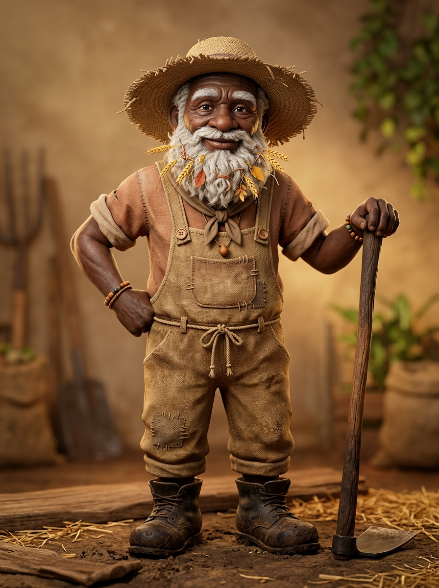

# 🌾 FICHA DE REFERENCIA 3D: MZEE SHAMBA (EL AGRICULTOR SABIO)

- **Elemento**: Mzee Shamba, Campesino Sabio y Guardián de la Granja
- **Archivo Destino**: `modelos/personajes/mzee_shamba.glb`
- **Modelador Asignado**: Claude Code (vía Blender `bpy`)
- **Estilo**: 3D estilizado entrañable y robusto (inspiración: figura paternal campesina estilo *Ghibli*, *Zelda*)

---

## 📏 PROPORCIONES Y COMPOSICIÓN
- **Estatura Total**: $1.52\text{ m}$ (unas 4.5 cabezas de proporción estilizada de anciano sabio).
- **Rostro y Barba**:
  - Expresión bondadosa, arrugas de sonrisa serena y ojos cálidos.
  - Gran barba tupida y rústica entretejida con espigas de trigo, briznas de hierba seca y hojas de roble (#d6bb78).
- **Sombrero Campesino**:
  - Sombrero ancho cónico de paja trenzada (#cfa861) que sombrea su rostro.
- **Atuendo de Labranza**:
  - Peto campesino de tela de saco desgastada en tonos tierra (#6e543b) con parches remendados en rodillas.
  - Camisa de lino crudo arremangada a los codos y botas gruesas de cuero con barro de campo.
- **Herramienta**:
  - Azadón o azada tradicional de mango de madera pulida (#543d28) con hoja de hierro forjado (#3b3e42), apoyado en el suelo como bastón.

---

## 🎨 PALETA DE MATERIALES (HEX)
| Material | Color HEX | Roughness | Metallic | Notas |
| :--- | :--- | :--- | :--- | :--- |
| `shamba_piel_anciano` | `#d9b896` | 0.65 | 0.0 | Piel curtida por el sol |
| `shamba_barba_paja` | `#d6bb78` | 0.85 | 0.0 | Barba con briznas de trigo |
| `shamba_sombrero` | `#cfa861` | 0.80 | 0.0 | Paja trenzada de cosecha |
| `shamba_peto_saco` | `#6e543b` | 0.90 | 0.0 | Tela de saco remendada |
| `shamba_hierro_azada` | `#3b3e42` | 0.35 | 0.6 | Hierro forjado de campo |
