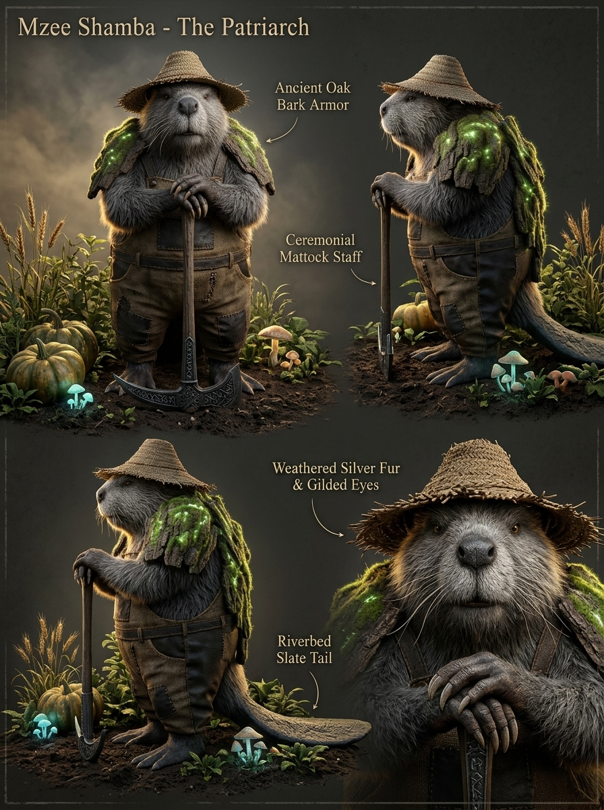

# 🌾 FICHA DE REFERENCIA 3D: MZEE SHAMBA (EL PATRIARCA CASTOR MÍTICO)



- **Elemento**: Mzee Shamba, Patriarca Agricultor del Linaje de los Castores Sagrados de Asili
- **Archivo Destino**: `modelos/personajes/mzee_shamba.glb`
- **Modelador Asignado**: Claude Code (vía Blender `bpy`)
- **Naturaleza del Personaje**: **Castor Ancestral Bípedo / Guardián Agrícola de las Raíces de El Kitovu**.
  - En la historia original del juego, Shamba afirma con orgullo: *"Los castores Shamba cuidábamos sus huertos y sus raíces, de generación en generación."*
  - En el tono realista y mítico de alta fantasía (inspiración: *God of War*, *Princess Mononoke*, *The Dark Crystal*), Mzee Shamba es un ser venerable, una criatura de la tierra robusta y sabia que funde la anatomía de un castor totémico milenario con la dignidad de un viejo maestro agricultor.
- **Papel Narrativo**: 100% idéntico al guion original. Es el primero que encuentra a Maisha tras su despertar, le ofrece sopa de zanahorias calientes junto al fuego y le entrega la orientación hacia el gran portal de raíces.

---

## 📏 PROPORCIONES Y ANATOMÍA MÍSTICA
- **Estatura y Silueta**: $1.55\text{ m}$ de altura (proporción pesada y sólida de 5 cabezas). Postura ligeramente encorvada por siglos de trabajo en la tierra, pero de porte venerable e inquebrantable.
- **Rostro y Hocico Sabio**:
  - Expresión bondadosa, serena y arrugada por el sol y la edad.
  - Incisivos de ámbar fósil pulido con vetas doradas.
  - Bigotes sensoriales que parecen zarcillos de raíz viva y sensible.
  - Barba tupida y anciana entretejida con espigas de trigo silvestre, paja y líquenes húmedos.
- **Cola de Laja de Pizarra Fluvial**:
  - Cola ancha y aplanada con textura de piedra pizarra erosionada por el agua y runas de tierra gastadas por el tiempo. Le sirve de tercer punto de apoyo natural al detenerse a descansar o contemplar el huerto.
- **Lomo y Hombros de Corteza**:
  - Hombros anchos con placas de corteza petrificada y brotes de musgo aterciopelado.
- **Indumentaria Campesina Ancestral**:
  - Sombrero cónico rústico de paja trenzada con borde desgastado.
  - Peto campesino de tela de saco áspera y cuero curtido con parches cosidos a mano con tendones vegetales.
  - Camisa de lino crudo arremangada y botas de cuero de viaje impregnadas de tierra fértil.
- **Herramienta: La Azada de la Raíz**:
  - Azada ceremonial con mango de madera de roble nudoso retorcido y pala de hierro forjado meteórico grabada con runas de fertilidad.

---

## 🎨 PALETA DE MATERIALES (HEX)
| Material | Color HEX | Roughness | Metallic | Emission | Función |
| :--- | :--- | :--- | :--- | :--- | :--- |
| `pelaje_castor_anciano`| `#423429` | 0.85 | 0.0 | - | Pelaje espeso y pardo oscuro con tonos ceniza |
| `barba_espigas_musgo` | `#b59e67` | 0.80 | 0.0 | - | Espigas secas, hebras de cáñamo y musgo |
| `cola_pizarra_laja` | `#4a5257` | 0.70 | 0.1 | - | Pizarra fluvial pulida y resistente |
| `corteza_hombros` | `#3b2c1e` | 0.90 | 0.0 | - | Corteza petrificada sobre el lomo |
| `sombrero_paja` | `#c9b07a` | 0.80 | 0.0 | - | Paja trenzada campesina |
| `peto_saco_cuero` | `#594a38` | 0.85 | 0.0 | - | Tela de cáñamo desgastada y cuero rústico |
| `incisivos_ambar` | `#d4882e` | 0.25 | 0.0 | 0.6 | Dientes fósiles de cuarzo ámbar |
| `hierro_azada_runas` | `#2d2f33` | 0.40 | 0.7 | 0.4 | Hierro forjado con sutil brillo rúnico tenue |

---

## 🦴 ESQUELETO Y RIGGING PARA BLENDER
```
root (suelo, y=0.0)
 └─ hips (pelvis ancha de castor, y=0.75m)
     ├─ spine_01 -> spine_02 -> chest -> neck -> head (y=1.40m)
     │    ├─ jaw (mandíbula inferior con incisivos)
     │    ├─ beard_root (huesos secundarios para la barba de espigas)
     │    ├─ hat_bone (sombrero de paja)
     │    └─ whiskers_L / whiskers_R
     ├─ shoulder_L/R -> arm_L/R -> forearm_L/R -> hand_L/R (socket para la Azada)
     ├─ tail_01 -> tail_02 -> tail_flat (cola ancha de pizarra para soporte e idle)
     └─ thigh_L/R -> calf_L/R -> foot_L/R (patas plantígradas firmes)
```

---

## 🎬 ANIMACIONES CLAVE
1. `idle_labranza`: Descansa ambas manos sobre el mango de la azada, apoyándose levemente en su cola de laja, observando el horizonte con respiración profunda.
2. `hablar_afable`: Gesticula suavemente con una mano mientras la otra sostiene la herramienta; la barba de espigas oscila sutilmente.
3. `cavar_tierra`: Clava la azada rúnica en los surcos del huerto de zanahorias con movimientos acompasados y firmes.
4. `ofrecer_cuenco`: Sostiene un cuenco humeante de arcilla con sopa de zanahorias hacia Maisha con calidez paternal.
