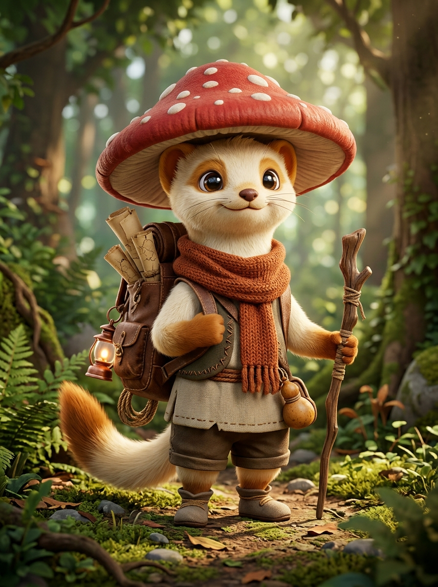

# 🍄 FICHA DE REFERENCIA 3D: PINO (EXPLORADOR DE LA CUNA)

- **Elemento**: Pino, Joven Explorador
- **Archivo Destino**: `modelos/personajes/pino.glb`
- **Modelador Asignado**: Claude Code (vía Blender `bpy`)
- **Estilo**: 3D estilizado / diorama de cuento (inspiración: armiño explorador estilo *Ghibli*, *Zelda: Link's Awakening*, *Kena*)

---

## 📏 PROPORCIONES Y COMPOSICIÓN
- **Estatura Total**: $1.15\text{ m}$ (unas 3.5 cabezas de proporción estilizada de pequeño aventurero ágil).
- **Cabeza y Rasgos**:
  - Cabeza tierna y expresiva con pelaje marfil (#ede5d8) y orejitas redondeadas con puntas tostadas.
  - Ojos oscuros vivaces y brillantes con reflejos curiosos.
- **Sombrero de Seta**:
  - Sombrero cónico suave en forma de hongo silvestre rojo brillante (#d43c31) con motas blancas dispersas (#fdfcf7).
- **Atuendo y Accesorios**:
  - Bufanda tejida de lana cobriza (#ba552b) que envuelve el cuello con una caída libre sobre la espalda.
  - Chaleco rústico de viaje y zurrón cruzado.
  - Mochila de cuero envejecido (#5c3a21) en la espalda cargada con mapas enrollados, cantimplora de calabaza seca y un pequeño farol de cobre.
  - Bastoncillo de caminante de rama pulida en la mano.

---

## 🎨 PALETA DE MATERIALES (HEX)
| Material | Color HEX | Roughness | Metallic | Notas |
| :--- | :--- | :--- | :--- | :--- |
| `pino_pelaje_crema` | `#ede5d8` | 0.65 | 0.0 | Pelaje suave aterciopelado |
| `pino_sombrero_rojo`| `#d43c31` | 0.45 | 0.0 | Sombrero de seta silvestre |
| `pino_motas_blancas`| `#fdfcf7` | 0.50 | 0.0 | Lunares del sombrero |
| `pino_bufanda_lana` | `#ba552b` | 0.85 | 0.0 | Lana tejida cálida |
| `pino_cuero_mochila`| `#5c3a21` | 0.70 | 0.0 | Cuero de aventurero |
| `pino_farolito` | `#c28542` | 0.30 | 0.4 | Cobre envejecido |
