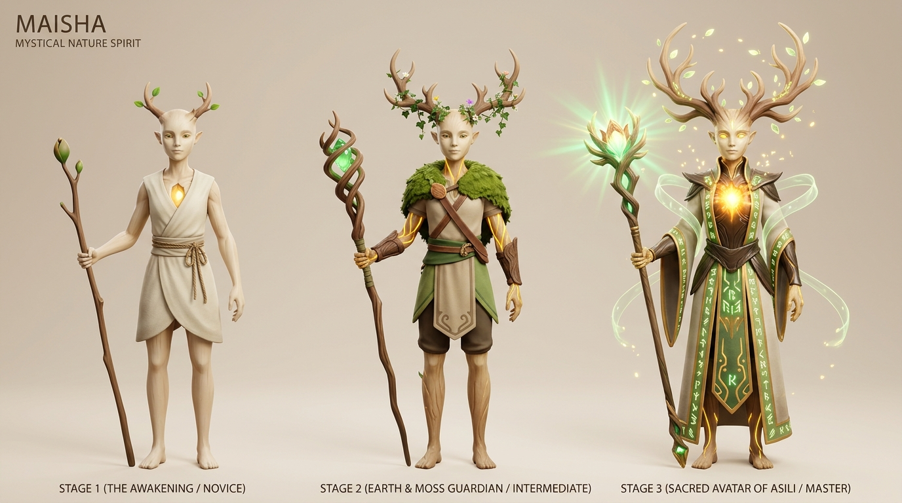
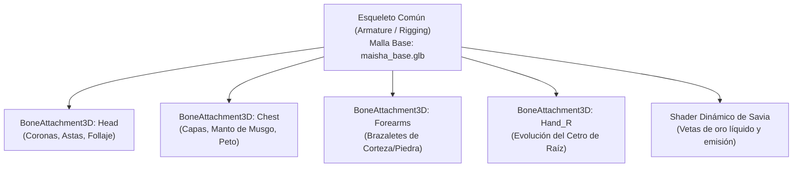

# 🛡️ SISTEMA MODULAR DE UPGRADES VISUALES 3D: MAISHA

> **Concepto de Diseño**: A medida que Maisha aprende nuevas Artes, purifica la corrupción de Giza y sube de nivel sus habilidades de vida, **su aspecto físico evoluciona visiblemente**.
> El jugador experimenta una progresión tangible y gratificante: su personaje refleja físicamente el poder y la sabiduría que va acumulando.

---

## 📐 ARQUITECTURA TÉCNICA 3D (BLENDER & GODOT 4.7)

Para que el modelado en Blender no requiera rehacer el personaje entero cada vez que se desbloquea una habilidad, se adopta una **arquitectura modular de capas y puntos de anclaje (Sockets)**:

### 1. Puntos de Anclaje de Hueso (`BoneAttachment3D` en Godot):
| Socket | Hueso del Armature | Elementos Equipables en 3D |
| :--- | :--- | :--- |
| **`Socket_Cabeza`** | `head` | Brotes tiernos $\to$ Astas de madera viva $\to$ Corona florecida de Asili |
| **`Socket_Espalda`** | `chest` | Capa simple de lino $\to$ Manto de musgo vivo $\to$ Manto rúnico de escriba |
| **`Socket_Torso`** | `spine_02` | Túnica de viajero $\to$ Peto de corteza templada $\to$ Coraza sagrada de madera milenaria |
| **`Socket_Brazos`** | `forearm_L / R` | Sin brazaletes $\to$ Brazaletes de madera nudosa $\to$ Protectores rúnicos |
| **`Socket_Mano`** | `hand_R` | Cetro de rama $\to$ Cetro templado con gema $\to$ Gran Báculo Ancestral |

### 2. Progresión Dinámica por Shaders y Partículas:
* **El Corazón de Asili**:
  * *Nivel 1 (Inicial)*: Emisión tenue ($0.8$), luz dorada interior suave.
  * *Nivel 2 (Intermedio)*: Emisión media ($1.4$), sutiles vetas doradas que irradian por el pecho y hombros.
  * *Nivel 3 (Maestro)*: Emisión brillante ($2.0$), vetas de oro líquido vivas y partículas de esporas doradas en suspensión alrededor del cuerpo.

---

## 🌟 LAS 3 GRANDES FASES DE EVOLUCIÓN VISUAL

| Fase | Título | Momento de la Historia | Características Visuales |
| :--- | :--- | :--- | :--- |
| **Fase 1** | **El Despertar** | Comienzo en El Kitovu y primeros caminos | Ser místico sobrio y ágil. Astas incipientes de madera tierna con 2 hojitas verdes. Túnica básica de lino arena/marfil. Cetro humilde de rama de roble. Corazón de Asili con brillo suave. |
| **Fase 2** | **Guardián del Musgo** | Purificación de Cuna de Musgo y Lago Espejo | Astas más desarrolladas y esbeltas con follaje denso y pequeñas flores silvestres. Manto de musgo vivo sobre los hombros con broche tallado. Vetas doradas visibles en brazos. Cetro reforzado con gema esmeralda brillante. |
| **Fase 3** | **Avatar de Asili** | Desbloqueo de Sigilia y batalla final | Majestuosa corona de astas vivas florecidas de luz etérea. Manto ceremonial de escriba con runas ancestrales bordadas. Peto de corteza sagrada. El Corazón de Asili resplandece en su plenitud como un sol interior. Báculo Ancestral que canaliza haces de energía vital. |

---

## 🛠️ INSTRUCCIONES PARA CLAUDE AL MODELAR EN BLENDER
1. Modelar la **Malla Base** (`maisha_base.glb`) con el cuerpo andrógino desnudo/túnica interior y el esqueleto bien pesado (`weight painted`).
2. Modelar cada pieza de atuendo o accesorio como un sub-objeto o malla independiente (`mesh`) con su origen centrado en el punto de anclaje correspondiente.
3. De este modo, en Godot 4.7 podemos activar o desactivar cada pieza con una sola línea de código (`mesh_capa.visible = true`) según el progreso de la partida.
