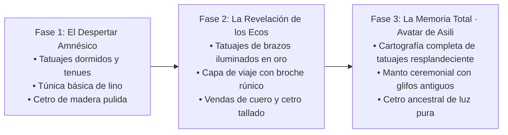

# 🌟 SISTEMA DE UPGRADES VISUALES: LA MEMORIA DEL OLVIDO (MAISHA)

> **Concepto Original (Feedback de Iam)**: En lugar de un árbol de vida genérico con cuernos que brotan, la evolución visual de Maisha se articula en torno a los **Tatuajes Ancestrales Mnemotécnicos** que Maisha se grabó en el cuerpo antes de perder la memoria, junto con el enriquecimiento de sus ropajes y el Cetro de Raíz.

---

## 🧭 LAS 3 FASES DE EVOLUCIÓN VISUAL

---

### 1️⃣ Fase 1: El Despertar Amnésico (Inicio · El Kitovu)
* **Estado de los Tatuajes**:
  * Líneas oscuras, apagadas y mates en ambos antebrazos y clavícula. Parecen cicatrices arcanas grabadas con tinta de raíz vieja.
* **Atuendo**:
  * Túnica sencilla de lino crudo deshilachado en los bordes (#d5caa8).
  * Sin capa pesada ni brazales; aspecto humilde, desprotegido y vulnerable.
* **Cetro**:
  * Vara simple de madera de roble pulida por el tiempo, con una semilla incipiente que apenas emite una débil chispa esmeralda.
* **Corazón de Asili**:
  * Pulso tenue y rítmico, como una pequeña brasa de oro líquido que empieza a avivarse.

---

### 2️⃣ Fase 2: La Revelación de los Ecos (Nivel Medio · La Raíz y El Bosque)
* **Estado de los Tatuajes**:
  * Los tatuajes de los antebrazos y el cuello se encienden con **savia dorada luminosa permanente**.
  * Al desbloquear los Ecos 1 a 5, comienzan a emerger formas reconocibles en la piel: círculos de agua, espirales de crecimiento y el glifo del Primer Árbol.
* **Atuendo**:
  * Se equipa una capa de viaje asimétrica más gruesa en verde musgo profundo (#3e4b34) sujeta con un broche rúnico de bronce mate.
  * Brazales de cuero curtido reforzado en los antebrazos que dejan ver los tatuajes luminosos entre las correas.
* **Cetro**:
  * El cetro incorpora una filigrana de raíces entrelazadas que sostienen una semilla viva palpitante de luz esmeralda más intensa.

---

### 3️⃣ Fase 3: La Memoria Total · Avatar de Asili (Nivel Maestro · Sigilia y Clímax)
* **Estado de los Tatuajes**:
  * **La cartografía mnemotécnica completa despierta**: Los tatuajes se extienden en filigrana dorada brillante por el pecho, la espalda entera, los hombros y hasta la sien.
  * Emiten un aura sutil de partículas áureas de vida; el mapa revela la verdad ancestral de la separación entre Maisha y Mauti.
* **Atuendo**:
  * Manto ceremonial de escriba antiguo en tonos marfil y azul noche con runas protectoras bordadas en hilo de oro.
  * Hombreras ligeras de cuero vegetal esculpido con motivos de hojas perennes.
* **Cetro**:
  * Gran Báculo Ancestral de madera cósmica milenaria con una semilla sagrada envuelta en espirales de oro y luz viva que disipa la bruma de Giza con cada movimiento.
* **Corazón de Asili**:
  * Brilla con la plenitud de un pequeño sol sagrado en el pecho.

---

## 🛠️ IMPLEMENTACIÓN TÉCNICA EN BLENDER Y GODOT

1. **Malla Base Única (`maisha.glb`)**:
   - Claude modela la anatomía humana estilizada de Maisha con una textura UV que contiene el mapa de los tatuajes en una máscara de textura (`tatuajes_mascara.png`).
2. **Shader de Tatuajes en Godot (`shaders/maisha_piel.gdshader`)**:
   - El shader interpola el canal de emisión de los tatuajes mediante un parámetro `uniform float despertar_memoria : hint_range(0.0, 1.0)`.
   - Cuando el jugador progresa y recupera Ecos, el parámetro sube gradualmente iluminando los tatuajes sin necesidad de cambiar de modelo 3D.
3. **Piezas Modulares (`BoneAttachment3D`)**:
   - La capa, los brazales y el manto ceremonial son mallas secundarias que se acoplan en los huesos `shoulder_L`, `forearm_L` y `chest` según la fase del juego.
